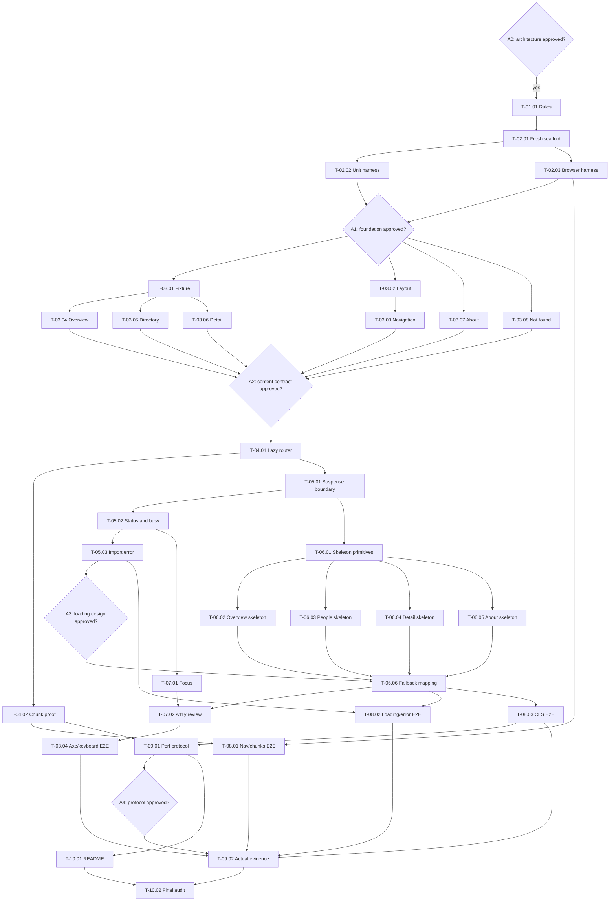

# TASK_DECOMPOSITION.md

> **Exercise 1.1 — Performance & Resiliency Architectural Upgrades**  
> **Project:** Pioneer Atlas (new greenfield React SPA)  
> **Status:** PROPOSED / PLANNING ONLY — **NOT APPROVED FOR IMPLEMENTATION**  
> **Created:** 2026-11-20  
> **Rule:** This file is the only project artifact authorized in the planning phase. No application scaffold, source code, dependencies, tests, commits, or measurements have been created or executed.

## 0. Decision checkpoint and contract status

- **A0 — Human architecture approval: BLOCKED / awaiting approval.** Before T-01.01, approve or amend the concept, routes, stack, test strategy, and performance criteria. Approval is not implied by possession of this document. No implementation tasks may start before A0.
- **A1 — Foundation approval:** after scaffold/test harness tasks T-02.01–T-02.03; verify tool versions and commands in the actual environment before feature work.
- **A2 — Application contract review:** after T-03.01–T-03.08; approve content shapes, navigation contracts, and reference layouts before lazy-route implementation and skeleton measurements.
- **A3 — Loading/A11y design review:** after T-05.01–T-05.03; approve boundary/error behavior and announcement conventions before skeleton integration and browser validation.
- **A4 — Measurement protocol review:** after T-08.03 and T-09.01; approve measured environments, aggregation, thresholds, and evidence format before final performance evaluation.

If an approval changes the contract, update this WBS explicitly first; never silently change implementation scope.

## 1. Exercise overview and project concept

**Goal.** Build a *new* client-side educational browser for six computing pioneers to demonstrate route-specific JavaScript chunks, resilient loading surfaces, dimension-matched skeletons, stable layouts, and accessible navigation. This is not a migration/refactor: there is no existing application to inspect or reuse.

**Concrete user journeys.** A visitor lands on an overview, opens the searchable directory, selects one profile, uses browser Back/Forward, visits About, and sees a helpful page for an invalid URL or missing profile. On a cold visit, JavaScript for an unvisited route is fetched on demand; a meaningful skeleton occupies the target page's reserved geometry. A failed JS chunk shows a recoverable error view instead of a blank page.

**Scope:** locally bundled, immutable sample profile data; local-only name search; responsive header/navigation; page skeletons and a shared announcement strategy; production build verification; deterministic browser throttling; static-host deployment documentation. Six illustrative entries are Ada Lovelace, Alan Turing, Grace Hopper, Margaret Hamilton, Donald Knuth, and Radia Perlman. Copy must be concise and checked for factual correctness before publishing.

**Explicitly out of scope:** backend/API/database, logins, account settings, user-generated data, pagination, analytics SaaS, global state libraries, animation frameworks, server-side rendering, service workers, route-data loaders, prefetching, complex caching, infinite scrolling, production hosting, and artificial `setTimeout` delays in production code. All route loading concerns **JavaScript module loading**, not simulated network data fetching.

### Route contract

| Route | Lazy page module | Primary content and stable structure | Loading view | Behavior |
|---|---|---|---|---|
| `/` | `OverviewPage.tsx` | Heading; intro/feature panel; three featured-profile cards | `OverviewSkeleton` | Landing page; links into directory |
| `/people` | `PeoplePage.tsx` | Heading; labeled search control; six-card responsive grid or filtered empty state | `PeopleSkeleton` | Case-insensitive local name filtering; links to detail |
| `/people/:personId` | `PersonPage.tsx` | Heading; metadata panel; summary; contribution list | `PersonSkeleton` | Valid ID renders; unknown ID displays in-page not-found message |
| `/about` | `AboutPage.tsx` | Heading; three informational sections | `AboutSkeleton` | Explains exercise and demo limitations |
| `*` | `NotFoundPage.tsx` | Heading; error text; home/directory links | Generic stable loading frame | Invalid URL still stays inside app shell |

**Canonical fixture contract:** six stable slug IDs; `Person = { id: string; name: string; era: string; field: string; summary: string; contributions: readonly string[] }`. `getPersonById(id)` returns `Person | undefined`. Search matches trimmed, lowercased names; empty query returns all six; fixtures are immutable. No external image requests: avatar initials inside fixed-size CSS circles.

**Responsive design reference viewports:** 375 × 812 (one column), 768 × 1024 (two columns when space allows), 1440 × 900 (three columns); layouts must also handle 320 px width and 200% zoom without horizontal page overflow. Cards and skeletons use the same tokens, grid, spacing, typography, and minimum block sizes. Dynamic content may exceed the reference heights; track actual differences rather than pretending fixed heights can guarantee zero CLS.

## 2. Technology stack and rationale

| Concern | Choice | Why / constraints |
|---|---|---|
| UI | React + TypeScript | Native `lazy()`/`Suspense`, explicit typed props; no complex framework |
| Build/dev | Vite `react-ts` template | Minimal ESM build, hashed chunks, inspectable manifest; build-time chunk evidence |
| Routing | `react-router` in **Declarative Mode** (`BrowserRouter`, `Routes`, `Route`, `NavLink`) | Small multi-route SPA; no framework/server/data-router setup needed |
| Styling | Plain CSS + CSS Modules for page/skeleton-specific rules | No runtime CSS engine or UI library; explicit dimensions and reduced-motion support |
| State | Local React state and tiny Context for cross-route status only | Search needs local state; shared announcements need one provider; avoid Redux/Zustand |
| Unit/components | Vitest, React Testing Library, `@testing-library/user-event`, `@testing-library/jest-dom`, jsdom | Vite-aligned, observable UI behavior |
| Browser E2E | Playwright **Chromium** | Real navigation, request interception, screen dimensions, keyboard, layout-shift observation |
| Accessibility scan | `@axe-core/playwright` (development-only) | Automated WCAG rule coverage; not a substitute for screen-reader review |
| Build inspection | Vite `build.manifest=true` + Node built-in `fs` script | Verify actual production route chunk graph without an analyzer dependency |
| Performance telemetry | Browser `PerformanceObserver` (`layout-shift`) + DevTools/Lighthouse manual cross-check | No permanent app analytics dependency; measure relevant lab flows |
| Package manager | npm; commit lockfile when implementation is authorized | Universal, simple reproducibility |
| Runtime requirement | Node LTS satisfying the selected Vite and Vitest engines (check compatibility at A1) | Avoid guessing versions before installation |

**Version policy.** At T-02.01 inspect the then-current compatibility ranges and pin actual compatible package versions in `package-lock.json`. This plan does not assert that any package has been installed. React Router's current declarative imports are from `react-router`, not `react-router-dom`. npm scripts should be preserved as named below; versions are recorded in README only after real installation.

**Justification of optional tooling:** Playwright is justified because static unit tests cannot reliably prove route chunks fetched on first use or measure rendered CLS; axe-core is justified for repeatable ARIA/landmark checks. Avoid an additional bundle analyzer, CSS framework, testing runner, mocking service, API client, fake latency package, or telemetry SDK.

## 3. Frontend architecture

### 3.1 Hierarchy and boundary placement

```text
main.tsx
└── App (BrowserRouter + RouteFeedbackProvider)
    └── AppLayout [eager, permanent]
        ├── SkipLink / header / SiteNav [eager]
        ├── RouteAnnouncement [eager, persistent role=status]
        ├── main#main-content [eager]
        │   └── AppRoutes (route declarations only; eager)
        │       ├── /             → RouteBoundary → lazy(OverviewPage)
        │       ├── /people       → RouteBoundary → lazy(PeoplePage)
        │       ├── /people/:id   → RouteBoundary → lazy(PersonPage)
        │       ├── /about        → RouteBoundary → lazy(AboutPage)
        │       └── *             → RouteBoundary → lazy(NotFoundPage)
        └── footer [eager]

RouteBoundary (one instance per resolved route)
└── RouteErrorBoundary (handles rejected dynamic imports)
    └── Suspense(fallback=RouteLoadingState + mapped route skeleton)
        └── RouteReadySignal → page content
```

**Critical separation:** `AppRoutes.tsx` must declare lazy functions at module scope (`const PeoplePage = lazy(() => import('../pages/PeoplePage'))`), not import page modules eagerly. Never barrel-import pages in an eager module. Shared fixture or CSS modules may produce additional shared chunks; this does not violate splitting if unvisited page component chunks are absent from the initial route's requests.

**Boundary strategy:** persistent header/footer and navigation **outside** Suspense; route-specific suspense instances within `main`. Show the destination-shaped fallback on cold route loading, retain navigation usability, and remove fallback when the route module resolves. Returning to a warm chunk is allowed to render immediately (there may be no fallback). There are no nested data Suspense boundaries because all domain data are synchronous.

**Resilience:** a real Error Boundary wraps Suspense. A rejected import is not handled by Suspense as a loading event. The fallback has understandable error text, a Home link and a **Reload** action. `React.lazy` can cache a rejection; don't promise that rerendering the same boundary retries a failed import. Re-key or reset visual error state on pathname changes when appropriate, but retry via a full page reload. A persistent connection failure may remain unsuccessful.

### 3.2 Skeleton architecture and geometry

- `SkeletonPrimitives.tsx` supplies decorative rectangular/circular shapes and shared class names; it has **no ARIA status role** and is hidden from accessibility APIs when rendered as decoration.
- Individual `OverviewSkeleton`, `PeopleSkeleton`, `PersonSkeleton`, `AboutSkeleton` match their corresponding page's heading, panels, card count/grid, spacing and bounded block heights at the three reference viewports. Use shared CSS variables (`--page-width`, grid gap, card min-block-size, avatar size, typography line-height) and `scrollbar-gutter: stable` where supported.
- `RouteLoadingState` owns the **busy loading region** (`aria-busy="true"`), visible loading label, and mapped visual skeleton. Loaded page content does not stay busy; persistent `RouteAnnouncement` owns the **single polite live region** (`role="status"` implies `aria-live="polite"`; don't redundantly add both).
- `RouteReadySignal` updates the persistent status once when a lazy route resolves. Only status changes, not each placeholder cell, are announced. The live region is mounted before route changes; avoid multiple competing live regions and duplicate text. `RouteFocusManager` later focuses the newly loaded heading on client-side navigation, not on initial page load, without trapping focus.
- Prefer no movement animation. Any optional pulsing/shimmer has `@media (prefers-reduced-motion: reduce)` disabling it. Never use animation to manipulate measured geometry.

**CLS caveat:** skeleton-to-content visual similarity reduces layout shift but cannot universally guarantee CLS = 0; font metrics, scrollbars, dynamic text, input focus, zoom, and different viewport sizes matter. Fixed placeholder sizes are not enough unless matching real render dimensions and context. Do not inject artificial delay in the application to make fallbacks appear; intercept/delay route JS **only inside tests**.

### 3.3 Accessibility and navigation contract

Use `<header>`, `<nav aria-label="Primary">`, `<main id="main-content">`, `<footer>`, one visible `<h1>` per route, and native links/inputs. Skip link targets main and is visible on focus. `NavLink` exposes current route with `aria-current="page"` (router behavior); do not add `aria-pressed` to links. Search has a visible `<label>`, empty results are meaningful text, and all cards are keyboard links. Route announcements should say **Loading [page]** only when a fallback actually mounts, then **[page] loaded** when resolved; route errors use one clear error announcement, avoiding duplicate assertive messages. Focus lands at the new route's heading after client-side navigation, including after suspense resolution; do not steal focus on initial load. Verify real screen-reader behavior manually.

### 3.4 Project tree (future only — not created in this phase)

```text
pioneer-atlas/
├── TASK_DECOMPOSITION.md             # this document (only current artifact)
├── PROJECT_RULES.md                   # T-01.01, future
├── README.md                          # T-10.01, future
├── package.json / package-lock.json   # T-02.01 onward
├── index.html / tsconfig*.json / eslint.config.js
├── vite.config.ts                     # manifest and Vitest configuration
├── playwright.config.ts               # T-02.03
├── scripts/
│   └── verify-chunks.mjs              # T-04.02
├── docs/
│   ├── PERFORMANCE.md                 # T-09.01
│   ├── ACCESSIBILITY.md               # T-07.02
│   └── VALIDATION.md                  # T-09.02, T-10.02
├── src/
│   ├── main.tsx
│   ├── app/
│   │   ├── App.tsx
│   │   ├── AppLayout.tsx
│   │   └── AppRoutes.tsx
│   ├── components/
│   │   ├── navigation/{SiteNav.tsx,SkipLink.tsx}
│   │   ├── routing/{RouteBoundary.tsx,RouteErrorBoundary.tsx}
│   │   ├── loading/{SkeletonPrimitives.tsx,RouteLoadingState.tsx,
│   │   │              OverviewSkeleton.tsx,PeopleSkeleton.tsx,
│   │   │              PersonSkeleton.tsx,AboutSkeleton.tsx,
│   │   │              skeletons.module.css}
│   │   └── a11y/{RouteFeedbackProvider.tsx,RouteAnnouncement.tsx,
│   │                  RouteReadySignal.tsx,RouteFocusManager.tsx}
│   ├── domain/people.ts
│   ├── data/people.ts
│   ├── pages/
│   │   ├── OverviewPage.tsx + OverviewPage.module.css
│   │   ├── PeoplePage.tsx + PeoplePage.module.css
│   │   ├── PersonPage.tsx + PersonPage.module.css
│   │   ├── AboutPage.tsx + AboutPage.module.css
│   │   └── NotFoundPage.tsx + NotFoundPage.module.css
│   ├── styles/{tokens.css,global.css}
│   └── test/setup.ts
├── tests/
│   ├── unit/people.test.ts
│   ├── components/{AppLayout.test.tsx,SiteNav.test.tsx,
│   │               OverviewPage.test.tsx,PeoplePage.test.tsx,
│   │               PersonPage.test.tsx,AboutPage.test.tsx,
│   │               NotFoundPage.test.tsx,RouteBoundary.test.tsx,
│   │               RouteFeedback.test.tsx,RouteErrorBoundary.test.tsx,
│   │               SkeletonPrimitives.test.tsx,OverviewSkeleton.test.tsx,
│   │               PeopleSkeleton.test.tsx,PersonSkeleton.test.tsx,
│   │               AboutSkeleton.test.tsx,RouteFocusManager.test.tsx}
│   ├── integration/{lazy-routes.test.tsx,loading-states.test.tsx,
│   │                   skeleton-mapping.test.tsx}
│   └── e2e/{navigation.spec.ts,code-splitting.spec.ts,
│               suspense-errors.spec.ts,geometry-cls.spec.ts,
│               accessibility.spec.ts}
└── dist/                               # generated, ignored, never source-controlled
```

Tree is a **planned file inventory**, not evidence of created files. Some scaffold-generated support files (e.g., TypeScript configs, `.gitignore`) may retain template-generated names; record and constrain those at T-02.01. No `src/` directory exists in the planning deliverable.

## 4. WBS hierarchy and work package outcomes

| WP | Package | Leaf tasks | Exit artifact / milestone |
|---|---|---|---|
| WP-01 | Specification & governance | T-01.01 | Human-approved rules and frozen scoped contract |
| WP-02 | Greenfield scaffold & test foundation | T-02.01–T-02.03 | Runnable empty app + test tooling |
| WP-03 | App shell, sample domain & five pages | T-03.01–T-03.08 | Five independently tested static page modules |
| WP-04 | Route-level splitting & build proof | T-04.01–T-04.02 | Lazy route table + manifest assertions |
| WP-05 | Suspense & resilient loading | T-05.01–T-05.03 | Shared boundaries, announcements, failure fallback |
| WP-06 | Dimension-matched skeletons | T-06.01–T-06.06 | Four tailored skeletons wired to routes |
| WP-07 | Accessibility & focus | T-07.01–T-07.02 | Navigation focus, reduced-motion and ARIA guidance |
| WP-08 | Browser-level verification | T-08.01–T-08.04 | Real-browser navigation/chunk/loading/CLS/a11y tests |
| WP-09 | Performance protocol & execution | T-09.01–T-09.02 | Repeatable measured validation record |
| WP-10 | Documentation & final handoff | T-10.01–T-10.02 | Runbook and auditable final DoD |

**Task sizing:** S = one cohesive file/component or short configuration step; M = one isolated feature with tests; L = an integration or repeatable measurement workflow. An L task must be subdivided during approval if it cannot be reviewed in a single PR. Every leaf below defines file boundaries, a proposed red test (or an honest N/A), and an atomic commit suggestion; commits require explicit authorization.

## 5. Detailed implementation task specifications

**Standard stage policy applied to every leaf:** (1) CONTRACT: confirm only listed files and objective criteria; (2) FAIL TEST: add or run an observable-behavior red test where meaningful, capture failure reason; (3) IMPLEMENT: minimum code; (4) REFACTOR: narrow cleanup with all relevant tests remaining green. For infrastructure, run a failing preflight/smoke check instead of inventing a meaningless unit test. For documentation/approval, mark automated test N/A and use document review, link validation, or commands as appropriate. **No test, tool, installation, change, commit, or result below has been performed at planning time.**

### T-01.01 — Freeze approved contract and coding rules

| Field | Execution-ready specification |
|---|---|
| **1. Task ID** | `T-01.01` |
| **2. Task name** | Freeze approved contract and coding rules |
| **3. Purpose** | Translate the approved greenfield design into AI-execution constraints. |
| **4. Scope** | Write project rules only after A0; preserve this WBS as the authoritative task index. |
| **5. Deliverables** | Task-scoped files listed in Field 6, implementing the outcome stated in Field 9, together with test/evidence required by Field 10. |
| **6. Exact files** | `PROJECT_RULES.md`; `TASK_DECOMPOSITION.md` (approval header/status only if explicitly instructed). |
| **7. Dependencies** | A0 human approval (blocking; no prerequisite implementation). |
| **8. Contract** | Rules must mandate per-task scope, staged contract-first work, real verification, no unauthorized dependencies, no auto-commit/push, no existing-project reuse, and task-specific reporting. |
| **9. Expected behavior** | Future agents can read consistent implementation boundaries before editing. |
| **10. Measurable acceptance criteria** | Rules cover all mandatory governance points; approval recorded with date/decisions; no source files written. |
| **11. Automated tests / RED stage** | N/A for pure governance; a manual checklist is the verification contract. |
| **12. Manual verification** | Review every section against the user brief; ensure exclusions and approval gates are explicit. |
| **13. Accessibility** | Ensure WCAG and screen-reader goals are not silently reduced. |
| **14. Performance** | Keep explicit production-build and CLS validation obligations. |
| **15. Risks / edge cases** | Architecture approved vaguely; agent interprets rules as permission to implement further tasks. |
| **16. Proposed commit — do not execute** | `docs: establish exercise execution rules` |
| **17. Complexity** | S |
| **18. Definition of Done** | Approved A0 choices documented; rule file complete, reviewed, and no unrelated files changed. |

**Stage handoff:** Contract → record expected red/preflight result (or reason N/A) → minimum implementation → refactor with relevant tests green → review diff; report results and propose, but **do not create**, the commit.

### T-02.01 — Scaffold fresh React/TypeScript Vite application

| Field | Execution-ready specification |
|---|---|
| **1. Task ID** | `T-02.01` |
| **2. Task name** | Scaffold fresh React/TypeScript Vite application |
| **3. Purpose** | Establish an intentionally empty, runnable starting point. |
| **4. Scope** | Use a fresh scratch scaffold and copy baseline files into the project root without overwriting `TASK_DECOMPOSITION.md`; remove Vite demo assets/components; install the selected `react-router` runtime dependency; set npm scripts for dev/build/preview/lint/typecheck. |
| **5. Deliverables** | Task-scoped files listed in Field 6, implementing the outcome stated in Field 9, together with test/evidence required by Field 10. |
| **6. Exact files** | `package.json`, `package-lock.json`, `index.html`, `.gitignore`, `eslint.config.js`, `tsconfig.json`, `tsconfig.app.json`, `tsconfig.node.json`, `vite.config.ts`, `src/main.tsx`, `src/app/App.tsx` (minimal placeholder). Remove scaffold demo files (`src/App.tsx`, `src/assets/react.svg`, `public/vite.svg`, and unused CSS) if generated. |
| **7. Dependencies** | T-01.01; A0. |
| **8. Contract** | Brand-new React+TS SPA; `npm run dev`, `npm run build`, `npm run lint`, `npm run typecheck` scripts; Vite manifest enabled; no router/pages/feature logic yet. Check actual installed versions and Node engines. |
| **9. Expected behavior** | One minimal semantic placeholder renders from local dev server. |
| **10. Measurable acceptance criteria** | Clean install creates lock; dev startup, typecheck, lint and build exit 0; `dist/.vite/manifest.json` generated by build; no Vite demo copy remains. |
| **11. Automated tests / RED stage** | Infrastructure preflight: verify `src/app/App.tsx` and package scripts absent before scaffolding; no synthetic unit test. Later `npm run build` is smoke gate. |
| **12. Manual verification** | Run `node -v`, `npm -v`, `npm install`, `npm run dev`, `npm run typecheck`, `npm run lint`, `npm run build`; confirm manifest path. |
| **13. Accessibility** | Placeholder has one `<main>` and meaningful heading, no empty interactive widgets. |
| **14. Performance** | Use system fonts and no external fetches; check initial emitted assets. |
| **15. Risks / edge cases** | Vite scaffold on non-empty root may prompt to delete existing WBS; Node/Vite incompatibility; generated assets accidentally retained. |
| **16. Proposed commit — do not execute** | `chore: scaffold new pioneer atlas React app` |
| **17. Complexity** | M |
| **18. Definition of Done** | Only fresh scaffold files exist; actual commands/results recorded; no feature work or commit without approval. |

**Stage handoff:** Contract → record expected red/preflight result (or reason N/A) → minimum implementation → refactor with relevant tests green → review diff; report results and propose, but **do not create**, the commit.

### T-02.02 — Install and configure unit/component test harness

| Field | Execution-ready specification |
|---|---|
| **1. Task ID** | `T-02.02` |
| **2. Task name** | Install and configure unit/component test harness |
| **3. Purpose** | Enable observable contract-first test cycles. |
| **4. Scope** | Add Vitest, jsdom, RTL, user-event and jest-dom; expose test scripts; create one simple smoke test with real assertion. |
| **5. Deliverables** | Task-scoped files listed in Field 6, implementing the outcome stated in Field 9, together with test/evidence required by Field 10. |
| **6. Exact files** | `package.json`, `package-lock.json`, `vite.config.ts`, `src/test/setup.ts`, `tests/components/App.test.tsx` (bootstrap smoke test, independent of future AppLayout tests). |
| **7. Dependencies** | T-02.01; A1 review after foundation. |
| **8. Contract** | Test runner resolves TSX/React, `jest-dom` matchers, isolated setup; commands `npm run test:run` and `npm run test:watch`; tests focus on DOM behavior. |
| **9. Expected behavior** | Minimal App render can be tested without browser infrastructure. |
| **10. Measurable acceptance criteria** | One genuine initial smoke assertion passes; `npm run test:run` exits 0; no false positives from empty suites. |
| **11. Automated tests / RED stage** | Preflight `npm run test:run` should fail for missing script before setup; then create smoke test and run it. |
| **12. Manual verification** | Run headless suite; intentionally change fixture assertion locally to prove a failing test, revert it before handoff. |
| **13. Accessibility** | Use getByRole queries instead of CSS implementation details. |
| **14. Performance** | Keep jsdom tests separate from actual browser performance claims. |
| **15. Risks / edge cases** | Version/peer conflicts, duplicate config plugins, tests asserting only mocks. |
| **16. Proposed commit — do not execute** | `test: configure Vitest and Testing Library` |
| **17. Complexity** | S |
| **18. Definition of Done** | Fixture test and runner work; scripts and install evidence reported; no other features touched. |

**Stage handoff:** Contract → record expected red/preflight result (or reason N/A) → minimum implementation → refactor with relevant tests green → review diff; report results and propose, but **do not create**, the commit.

### T-02.03 — Configure production-preview Playwright harness

| Field | Execution-ready specification |
|---|---|
| **1. Task ID** | `T-02.03` |
| **2. Task name** | Configure production-preview Playwright harness |
| **3. Purpose** | Make real browser tests reproducible against generated bundles. |
| **4. Scope** | Add Chromium Playwright runner and WebServer configuration against 127.0.0.1:4173 preview; require build first; define timeouts, retries, trace-on-failure. |
| **5. Deliverables** | Task-scoped files listed in Field 6, implementing the outcome stated in Field 9, together with test/evidence required by Field 10. |
| **6. Exact files** | `package.json`, `package-lock.json`, `playwright.config.ts`. |
| **7. Dependencies** | T-02.01; can run in parallel with T-02.02 after foundation. |
| **8. Contract** | Runner uses isolated contexts and production preview, not Vite dev HMR; `npm run test:e2e` script; fixture port fixed with strictPort; browser installation documented. |
| **9. Expected behavior** | Production app can be opened with Playwright once built; browser network interceptions are possible. |
| **10. Measurable acceptance criteria** | `npm run build` then `npm run test:e2e` starts preview without port collision; no fake passing tests; no E2E cases yet until T-08.01. |
| **11. Automated tests / RED stage** | Preflight `npm run test:e2e` missing-script failure; no meaningless E2E test required in this configuration-only task. |
| **12. Manual verification** | Run `npx playwright install chromium`; `npm run build`; `npm run test:e2e` (record no-test exit if no cases yet); check preview startup. |
| **13. Accessibility** | Future project tests must cover keyboard + assistive workflow in real browser. |
| **14. Performance** | Use production build so chunk sizes and URLs reflect delivery; isolate browser cache. |
| **15. Risks / edge cases** | Runner exits on zero tests; Chromium missing; port conflict; request interception and service workers. |
| **16. Proposed commit — do not execute** | `test: configure Chromium browser test harness` |
| **17. Complexity** | S |
| **18. Definition of Done** | Runnable runner configuration and realistic preflight evidence documented; no page tests prematurely implemented. |

**Stage handoff:** Contract → record expected red/preflight result (or reason N/A) → minimum implementation → refactor with relevant tests green → review diff; report results and propose, but **do not create**, the commit.

### T-03.01 — Define person domain and immutable fixture

| Field | Execution-ready specification |
|---|---|
| **1. Task ID** | `T-03.01` |
| **2. Task name** | Define person domain and immutable fixture |
| **3. Purpose** | Create one consistent data contract for pages and tests. |
| **4. Scope** | Write six locally bundled records, type interfaces, pure lookup and search functions; no fetch, storage, or state library. |
| **5. Deliverables** | Task-scoped files listed in Field 6, implementing the outcome stated in Field 9, together with test/evidence required by Field 10. |
| **6. Exact files** | `src/domain/people.ts`, `src/data/people.ts`, `tests/unit/people.test.ts`. |
| **7. Dependencies** | T-02.02. |
| **8. Contract** | Unique slug IDs; immutable exported collection; getPersonById exact match or undefined; search trim + case-insensitive name match, empty input returns all; no mutation. |
| **9. Expected behavior** | Directory and detail pages share stable deterministic content. |
| **10. Measurable acceptance criteria** | 6 unique IDs; 6 valid short summaries; search empty/all, mixed-case, whitespace, unknown ID, no mutation tests pass. |
| **11. Automated tests / RED stage** | Write failing pure function tests first; run `npm run test:run -- tests/unit/people.test.ts` before and after. |
| **12. Manual verification** | Review fixture prose, IDs and any unsupported historical claims. |
| **13. Accessibility** | Data itself needs no ARIA; names/fields remain accessible plain text. |
| **14. Performance** | Avoid external images/HTTP and huge fixture payloads; route fixture can be code-split with consumers. |
| **15. Risks / edge cases** | Incorrect biographical facts; missing ID; subtly mutable arrays. |
| **16. Proposed commit — do not execute** | `feat: add typed pioneer directory fixtures` |
| **17. Complexity** | S |
| **18. Definition of Done** | Domain behavior and fixture tests green; six IDs frozen for route tests. |

**Stage handoff:** Contract → record expected red/preflight result (or reason N/A) → minimum implementation → refactor with relevant tests green → review diff; report results and propose, but **do not create**, the commit.

### T-03.02 — Create persistent semantic layout and tokens

| Field | Execution-ready specification |
|---|---|
| **1. Task ID** | `T-03.02` |
| **2. Task name** | Create persistent semantic layout and tokens |
| **3. Purpose** | Provide a stable shell outside every lazy route. |
| **4. Scope** | Implement header, main, footer and child slot; global typography/responsive tokens; baseline layout CSS; no route/page logic yet. |
| **5. Deliverables** | Task-scoped files listed in Field 6, implementing the outcome stated in Field 9, together with test/evidence required by Field 10. |
| **6. Exact files** | `src/app/AppLayout.tsx`, `src/app/App.tsx`, `src/styles/tokens.css`, `src/styles/global.css`, `tests/components/AppLayout.test.tsx`. |
| **7. Dependencies** | T-02.02. |
| **8. Contract** | Layout exposes stable `<main id="main-content">`; exactly one main; system-font stack; CSS width constraints; `scrollbar-gutter:stable`; footer outside route slot. |
| **9. Expected behavior** | Shell does not unmount or jump when child content changes. |
| **10. Measurable acceptance criteria** | Semantic landmarks found by roles; page max width shared; no viewport horizontal overflow at 375 and 1440 in later browser gates. |
| **11. Automated tests / RED stage** | Failing RTL landmark/child-slot test before implementation; rerun test + typecheck. |
| **12. Manual verification** | Resize placeholder shell at 375, 768, 1440; inspect header/footer stability. |
| **13. Accessibility** | No duplicate main landmarks; retain visible focus defaults. |
| **14. Performance** | CSS `min-height` layout is not a claim of CLS=0; reserve slot without fixed overflow traps. |
| **15. Risks / edge cases** | Global style collisions; vh-based height causing scroll-jumps; blank main. |
| **16. Proposed commit — do not execute** | `feat: add semantic responsive application shell` |
| **17. Complexity** | M |
| **18. Definition of Done** | Shell passes DOM tests; CSS tokens documented; only listed shell files touched. |

**Stage handoff:** Contract → record expected red/preflight result (or reason N/A) → minimum implementation → refactor with relevant tests green → review diff; report results and propose, but **do not create**, the commit.

### T-03.03 — Build accessible primary navigation and skip link

| Field | Execution-ready specification |
|---|---|
| **1. Task ID** | `T-03.03` |
| **2. Task name** | Build accessible primary navigation and skip link |
| **3. Purpose** | Allow meaningful keyboard and client-side navigation. |
| **4. Scope** | Create links for Overview, People, About plus skip link; integrate into existing shell; active route styling via NavLink. |
| **5. Deliverables** | Task-scoped files listed in Field 6, implementing the outcome stated in Field 9, together with test/evidence required by Field 10. |
| **6. Exact files** | `src/components/navigation/SiteNav.tsx`, `src/components/navigation/SkipLink.tsx`, `src/app/AppLayout.tsx`, `src/app/App.tsx` (add the single BrowserRouter provider), `tests/components/SiteNav.test.tsx`. |
| **7. Dependencies** | T-03.02, T-02.02. |
| **8. Contract** | Links use React Router `NavLink`/`Link`; wrap App with one BrowserRouter so app stays runnable; nav landmark has label Primary; skip link points to #main-content; no button masquerading as navigation. |
| **9. Expected behavior** | User can tab and activate navigation without page reload once router is integrated. |
| **10. Measurable acceptance criteria** | 3 exact destination URLs; active `aria-current="page"`; skip link visible on focus; keyboard activated links verified in test router. |
| **11. Automated tests / RED stage** | Write failing tests inside MemoryRouter; verify role navigation, href, focus and current state. |
| **12. Manual verification** | Tab through navigation using keyboard; check outline visibility/skip link at 375px. |
| **13. Accessibility** | Native links, focus style, current page semantics, no redundant `aria-pressed`. |
| **14. Performance** | Keep nav eagerly loaded and dimensions stable; CSS hover should not alter box size. |
| **15. Risks / edge cases** | NavLink rendered without Router when tested incorrectly; skip target mismatch. |
| **16. Proposed commit — do not execute** | `feat: add keyboard-accessible site navigation` |
| **17. Complexity** | S |
| **18. Definition of Done** | RTL and keyboard tests pass; nav integrated without touching lazy routes. |

**Stage handoff:** Contract → record expected red/preflight result (or reason N/A) → minimum implementation → refactor with relevant tests green → review diff; report results and propose, but **do not create**, the commit.

### T-03.04 — Implement Overview static page

| Field | Execution-ready specification |
|---|---|
| **1. Task ID** | `T-03.04` |
| **2. Task name** | Implement Overview static page |
| **3. Purpose** | Provide purposeful landing content and measurable card structure. |
| **4. Scope** | Heading/intro/three featured links using fixture data; fixed avatar placeholders, bounded content cards; page-scoped CSS. |
| **5. Deliverables** | Task-scoped files listed in Field 6, implementing the outcome stated in Field 9, together with test/evidence required by Field 10. |
| **6. Exact files** | `src/pages/OverviewPage.tsx`, `src/pages/OverviewPage.module.css`, `tests/components/OverviewPage.test.tsx`. |
| **7. Dependencies** | T-03.01, T-02.02. |
| **8. Contract** | Exactly 3 featured profile links to valid `/people/:personId`; 1 h1; intro and cards rendered from fixture; no network fetching. |
| **9. Expected behavior** | Overview can be unit-rendered independently of router assembly. |
| **10. Measurable acceptance criteria** | 3 valid links, one h1 and accessible card names; responsive card geometry documented via tokens. |
| **11. Automated tests / RED stage** | Write failing RTL content/link test; render under MemoryRouter; then implement. |
| **12. Manual verification** | Inspect no truncation/overflow at 375/768/1440. |
| **13. Accessibility** | Use actual links with intelligible text; initials avatars aria-hidden. |
| **14. Performance** | Cards use planned min-block-size and shared grid tokens for later skeleton fidelity. |
| **15. Risks / edge cases** | Copy too long, cards uneven heights, accidental imports from other pages. |
| **16. Proposed commit — do not execute** | `feat: create overview landing page` |
| **17. Complexity** | S |
| **18. Definition of Done** | Standalone page tests green; scope limited to Overview assets. |

**Stage handoff:** Contract → record expected red/preflight result (or reason N/A) → minimum implementation → refactor with relevant tests green → review diff; report results and propose, but **do not create**, the commit.

### T-03.05 — Implement searchable People directory page

| Field | Execution-ready specification |
|---|---|
| **1. Task ID** | `T-03.05` |
| **2. Task name** | Implement searchable People directory page |
| **3. Purpose** | Exercise meaningful user interaction without backend complexity. |
| **4. Scope** | Render six cards and a visible labeled client-side text input; filter names; empty results message; no sorting or pagination. |
| **5. Deliverables** | Task-scoped files listed in Field 6, implementing the outcome stated in Field 9, together with test/evidence required by Field 10. |
| **6. Exact files** | `src/pages/PeoplePage.tsx`, `src/pages/PeoplePage.module.css`, `tests/components/PeoplePage.test.tsx`. |
| **7. Dependencies** | T-03.01, T-02.02. |
| **8. Contract** | Initial six visible entries; trim/case-insensitive search; zero results explicit; each item links to valid detail; search state local to page. |
| **9. Expected behavior** | Typing changes visible cards without new navigation or fetch. |
| **10. Measurable acceptance criteria** | Tests: 6 initial names, matching subset, blank restores 6, unmatched empty state, keyboard input and links. |
| **11. Automated tests / RED stage** | Create failing RTL user-event tests, implement minimal controlled input, rerun. |
| **12. Manual verification** | At 375px check label, input focus and one-column card list. |
| **13. Accessibility** | Real label and sensible empty text; avoid announcing every keystroke as an assertive alert. |
| **14. Performance** | Grid card heights follow CSS tokens; search changes are user-initiated and separately assessed from lazy-load CLS. |
| **15. Risks / edge cases** | Rapid input and Unicode names; focus lost during filtering; out-of-bounds text. |
| **16. Proposed commit — do not execute** | `feat: add searchable people directory` |
| **17. Complexity** | M |
| **18. Definition of Done** | All directory behaviors tested; no extra state libraries or remote calls. |

**Stage handoff:** Contract → record expected red/preflight result (or reason N/A) → minimum implementation → refactor with relevant tests green → review diff; report results and propose, but **do not create**, the commit.

### T-03.06 — Implement Person detail and unknown-ID state

| Field | Execution-ready specification |
|---|---|
| **1. Task ID** | `T-03.06` |
| **2. Task name** | Implement Person detail and unknown-ID state |
| **3. Purpose** | Give detail route substantive content and robust local ID handling. |
| **4. Scope** | Use `useParams` to find record; render title, era/field, summary and contributions; if ID absent, in-page Not Found with directory link. |
| **5. Deliverables** | Task-scoped files listed in Field 6, implementing the outcome stated in Field 9, together with test/evidence required by Field 10. |
| **6. Exact files** | `src/pages/PersonPage.tsx`, `src/pages/PersonPage.module.css`, `tests/components/PersonPage.test.tsx`. |
| **7. Dependencies** | T-03.01, T-02.02. |
| **8. Contract** | Valid slug is deterministic; missing/invalid slug never crashes; no content fetch; preserve same overall frame for all people. |
| **9. Expected behavior** | Known person shows correct content; unknown slug explains absence inside same routed page. |
| **10. Measurable acceptance criteria** | Known ID and bogus ID tests, 1 h1 in either case, link to `/people`, contribution list accessible. |
| **11. Automated tests / RED stage** | Start with failing MemoryRouter param tests; then implement; check browser-sized markup. |
| **12. Manual verification** | Check heading and unknown-profile message with keyboard only. |
| **13. Accessibility** | Definition list/list for metadata; avatar decorative; no nested interactive cards. |
| **14. Performance** | Constrain summary width/line heights while preserving accessible full copy. |
| **15. Risks / edge cases** | Bad param treatment, ambiguous not-found UI, long contribution labels expanding card. |
| **16. Proposed commit — do not execute** | `feat: add resilient person detail page` |
| **17. Complexity** | M |
| **18. Definition of Done** | Both valid/invalid param paths pass isolated tests, no cross-route changes. |

**Stage handoff:** Contract → record expected red/preflight result (or reason N/A) → minimum implementation → refactor with relevant tests green → review diff; report results and propose, but **do not create**, the commit.

### T-03.07 — Implement About information page

| Field | Execution-ready specification |
|---|---|
| **1. Task ID** | `T-03.07` |
| **2. Task name** | Implement About information page |
| **3. Purpose** | Explain demo behavior and limitations in a genuinely separate route. |
| **4. Scope** | Build three small sections: purpose, why on-demand chunks, and measurement limitations; match stable structural layout. |
| **5. Deliverables** | Task-scoped files listed in Field 6, implementing the outcome stated in Field 9, together with test/evidence required by Field 10. |
| **6. Exact files** | `src/pages/AboutPage.tsx`, `src/pages/AboutPage.module.css`, `tests/components/AboutPage.test.tsx`. |
| **7. Dependencies** | T-02.02. |
| **8. Contract** | One h1 and three headed sections; clear statement that content is local and CLS=0 is only a target. |
| **9. Expected behavior** | About loads as a standalone module with no remote services. |
| **10. Measurable acceptance criteria** | Content tests find heading, section names, and accurate loading claim. |
| **11. Automated tests / RED stage** | Add failing content/landmark tests before writing component. |
| **12. Manual verification** | Check heading hierarchy and content at 375px. |
| **13. Accessibility** | h1 then h2 hierarchy, normal semantic paragraphs. |
| **14. Performance** | Stable three-block height reference for AboutSkeleton. |
| **15. Risks / edge cases** | Overpromising CLS results; extra functionality beyond scope. |
| **16. Proposed commit — do not execute** | `feat: add about and methodology page` |
| **17. Complexity** | S |
| **18. Definition of Done** | Accessible sections and tests green; independent page module. |

**Stage handoff:** Contract → record expected red/preflight result (or reason N/A) → minimum implementation → refactor with relevant tests green → review diff; report results and propose, but **do not create**, the commit.

### T-03.08 — Implement generic unknown-route page

| Field | Execution-ready specification |
|---|---|
| **1. Task ID** | `T-03.08` |
| **2. Task name** | Implement generic unknown-route page |
| **3. Purpose** | Avoid blank screens for invalid URLs. |
| **4. Scope** | Add simple 404 display, navigation back to main routes, scoped layout. |
| **5. Deliverables** | Task-scoped files listed in Field 6, implementing the outcome stated in Field 9, together with test/evidence required by Field 10. |
| **6. Exact files** | `src/pages/NotFoundPage.tsx`, `src/pages/NotFoundPage.module.css`, `tests/components/NotFoundPage.test.tsx`. |
| **7. Dependencies** | T-02.02. |
| **8. Contract** | Visible 404 heading and Home/People links; no redirect loops; remains inside shell. |
| **9. Expected behavior** | Unknown path has recoverable navigation. |
| **10. Measurable acceptance criteria** | One h1; both links have correct href; page semantics tested. |
| **11. Automated tests / RED stage** | Write failing RTL component tests; tab links manually. |
| **12. Manual verification** | Open an invalid path in a browser and activate Home and People links. |
| **13. Accessibility** | Native links with visible focus; avoid automatic focus trap. |
| **14. Performance** | Uses generic reserved fallback when cold-loaded. |
| **15. Risks / edge cases** | Unknown path accidentally matches `/people/:personId`; links cause full-page reload. |
| **16. Proposed commit — do not execute** | `feat: add unknown-route recovery page` |
| **17. Complexity** | S |
| **18. Definition of Done** | Component tests pass; ready for wildcard routing. |

**Stage handoff:** Contract → record expected red/preflight result (or reason N/A) → minimum implementation → refactor with relevant tests green → review diff; report results and propose, but **do not create**, the commit.

### T-04.01 — Integrate declarative routes using lazy imports

| Field | Execution-ready specification |
|---|---|
| **1. Task ID** | `T-04.01` |
| **2. Task name** | Integrate declarative routes using lazy imports |
| **3. Purpose** | Ensure page modules are fetched on demand rather than eagerly imported. |
| **4. Scope** | Retain the existing single BrowserRouter and wire AppRoutes with five module-scope lazy() calls; temporary lightweight per-route Suspense text fallback; use AppLayout as persistent wrapper. No skeleton/error polish yet. |
| **5. Deliverables** | Task-scoped files listed in Field 6, implementing the outcome stated in Field 9, together with test/evidence required by Field 10. |
| **6. Exact files** | `src/app/App.tsx`, `src/app/AppRoutes.tsx`, `src/main.tsx` (only if provider mounting requires it), `tests/integration/lazy-routes.test.tsx`. |
| **7. Dependencies** | T-03.03, T-03.04, T-03.05, T-03.06, T-03.07, T-03.08. |
| **8. Contract** | Paths `/`, `/people`, `/people/:personId`, `/about`, `*`; each `lazy(() => import(...))` module declared at top level, no eager import of page components; route names stable. |
| **9. Expected behavior** | Direct visits and link navigation render the right module after import; cold load can show provisional text fallback. |
| **10. Measurable acceptance criteria** | All five routes render, unknown IDs handled, Back/Forward works; no route page modules statically imported by route table. |
| **11. Automated tests / RED stage** | Integration tests: async route resolution via MemoryRouter, correct route content and absence of other page content; initial contract test fails before router wiring. |
| **12. Manual verification** | Navigate to each route via links; hard refresh on `/people/example` in preview and note need for SPA fallback hosting. |
| **13. Accessibility** | Keep nav outside Suspense and stable h1 per resolved page. |
| **14. Performance** | No eager `import * as pages` barrel; avoid `import.meta.glob({ eager:true })` and route preloading. |
| **15. Risks / edge cases** | React.lazy default export requirement, route order (`*`), double BrowserRouter in tests, deployed fallback configuration. |
| **16. Proposed commit — do not execute** | `feat: add lazily loaded application routes` |
| **17. Complexity** | M |
| **18. Definition of Done** | All route integration tests green; each page declared via dynamic import; ready for build inspection. |

**Stage handoff:** Contract → record expected red/preflight result (or reason N/A) → minimum implementation → refactor with relevant tests green → review diff; report results and propose, but **do not create**, the commit.

### T-04.02 — Verify actual production route chunks

| Field | Execution-ready specification |
|---|---|
| **1. Task ID** | `T-04.02` |
| **2. Task name** | Verify actual production route chunks |
| **3. Purpose** | Turn code splitting from a source-code assertion into a verifiable build contract. |
| **4. Scope** | Write Node manifest inspector and named verify script; enforce unique lazy page entry bundles and check initial import graph; report manifest paths and byte sizes. |
| **5. Deliverables** | Task-scoped files listed in Field 6, implementing the outcome stated in Field 9, together with test/evidence required by Field 10. |
| **6. Exact files** | `scripts/verify-chunks.mjs`, `package.json`, `vite.config.ts` (only adjust manifest option if needed). |
| **7. Dependencies** | T-04.01. |
| **8. Contract** | Read `dist/.vite/manifest.json`; identify five `src/pages/*Page.tsx` entries with `isDynamicEntry`; ensure distinct emitted `.js` files; traverse entry `imports` to ensure unvisited page chunk is not an initial static dependency. Do not assert chunk count globally because Vite can create shared chunks. |
| **9. Expected behavior** | `npm run verify:chunks` fails if a page was eagerly bundled or manifest missing; succeeds only on real generated build. |
| **10. Measurable acceptance criteria** | Five distinguishable page dynamic entries; no unintended page chunk reachable by static imports from initial entry; generated paths/sizes recorded in stdout. |
| **11. Automated tests / RED stage** | Red-first script check against nonexistent `dist` (expected fail), then build; additionally use a temporary test fixture/manifest scenario (not production edits) with an eager page entry to prove failure. |
| **12. Manual verification** | Run `npm run build && npm run verify:chunks`; inspect network on cold `/` then `/people`. |
| **13. Accessibility** | No effect on landmarks; only verification tooling. |
| **14. Performance** | Check emitted JS, not only `React.lazy` text; report route JS and shared deps rather than claim total bytes savings without baseline. |
| **15. Risks / edge cases** | Manifest key differences across Vite versions, cross-chunk shared modules, browser cache hiding network. |
| **16. Proposed commit — do not execute** | `test: verify route chunks from Vite manifest` |
| **17. Complexity** | M |
| **18. Definition of Done** | Build + chunk validation executable; script fails meaningfully on invalid manifest; report shows real paths once run. |

**Stage handoff:** Contract → record expected red/preflight result (or reason N/A) → minimum implementation → refactor with relevant tests green → review diff; report results and propose, but **do not create**, the commit.

### T-05.01 — Extract reusable route Suspense boundary

| Field | Execution-ready specification |
|---|---|
| **1. Task ID** | `T-05.01` |
| **2. Task name** | Extract reusable route Suspense boundary |
| **3. Purpose** | Standardize fallbacks without making shell unavailable. |
| **4. Scope** | Create RouteBoundary accepting label, fallback and children; centralize Suspense; replace duplicated inline boundaries with provisional fallback. |
| **5. Deliverables** | Task-scoped files listed in Field 6, implementing the outcome stated in Field 9, together with test/evidence required by Field 10. |
| **6. Exact files** | `src/components/routing/RouteBoundary.tsx`, `src/app/AppRoutes.tsx`, `tests/components/RouteBoundary.test.tsx`. |
| **7. Dependencies** | T-04.01. |
| **8. Contract** | One Suspense boundary per active route, `fallback` from route map, permanent layout outside; JSX remains simple; no error boundary or announcer yet. |
| **9. Expected behavior** | Slow lazy child triggers fallback; resolved child replaces fallback; surrounding nav persists. |
| **10. Measurable acceptance criteria** | Controlled deferred-component test asserts fallback before resolve and child afterward; all routes still navigable. |
| **11. Automated tests / RED stage** | Create failing deferred Promise component test, resolve promise deterministically and rerun. |
| **12. Manual verification** | Test keyboard stays on accessible nav while route content loads. |
| **13. Accessibility** | Do not blank the whole app; boundary only covers route region. |
| **14. Performance** | Boundary around content only prevents header/footer replacement or artificial page geometry shifts. |
| **15. Risks / edge cases** | Suspense fallbacks not guaranteed to visibly mount for warm chunks or transition-suppressed navigations. |
| **16. Proposed commit — do not execute** | `feat: centralize route suspense boundaries` |
| **17. Complexity** | M |
| **18. Definition of Done** | Deterministic suspend/reveal component test green; no future skeletons created. |

**Stage handoff:** Contract → record expected red/preflight result (or reason N/A) → minimum implementation → refactor with relevant tests green → review diff; report results and propose, but **do not create**, the commit.

### T-05.02 — Implement persistent route loading feedback

| Field | Execution-ready specification |
|---|---|
| **1. Task ID** | `T-05.02` |
| **2. Task name** | Implement persistent route loading feedback |
| **3. Purpose** | Give screen-reader users accurate loading and completion announcements. |
| **4. Scope** | Add small status context/provider, permanent status node in layout, loading wrapper with busy state, ready signal on mounted page; integrate RouteBoundary and App. Keep visual fallback provisional pending WP-06. |
| **5. Deliverables** | Task-scoped files listed in Field 6, implementing the outcome stated in Field 9, together with test/evidence required by Field 10. |
| **6. Exact files** | `src/components/a11y/RouteFeedbackProvider.tsx`, `src/components/a11y/RouteAnnouncement.tsx`, `src/components/a11y/RouteReadySignal.tsx`, `src/components/loading/RouteLoadingState.tsx`, `src/components/routing/RouteBoundary.tsx`, `src/app/App.tsx`, `src/app/AppLayout.tsx`, `tests/components/RouteFeedback.test.tsx`. |
| **7. Dependencies** | T-05.01, T-03.02. |
| **8. Contract** | A single persistent `role="status"` node (implicitly polite); fallback renders `aria-busy="true"` on loading region and visible Loading label; resolved region is no longer busy; announce only active-route loading/resolution events by keyed route identity. |
| **9. Expected behavior** | Cold lazy route announces loading once then completion once; warm navigation need not announce a false loading phase; visible labels are not redundantly announced. |
| **10. Measurable acceptance criteria** | Exactly 1 persistent status node; fallback marked busy; no `aria-live` duplicated onto `role=status`; no stale loading after a newer route completes; no decorative skeleton spoken. |
| **11. Automated tests / RED stage** | Use RTL deferred imports and changing route keys; test status transitions, busy semantics, rapid-route stale events; red test first. |
| **12. Manual verification** | Use NVDA+Chrome or VoiceOver+Safari later in A11y review; here inspect accessibility tree and visible fallback. |
| **13. Accessibility** | Status output always mounted before changes; no arbitrary assertive alerts for normal loading. |
| **14. Performance** | Tiny context avoids broad rerenders; never put JS request progress tracking into app production code. |
| **15. Risks / edge cases** | Announcing loading twice, calling setState in render, stale completion after navigation, live region nested in aria-busy subtree. |
| **16. Proposed commit — do not execute** | `feat: announce accessible route loading lifecycle` |
| **17. Complexity** | M |
| **18. Definition of Done** | Status/busy tests green with rapid-navigation case; one live region only; not yet claim screen-reader certification. |

**Stage handoff:** Contract → record expected red/preflight result (or reason N/A) → minimum implementation → refactor with relevant tests green → review diff; report results and propose, but **do not create**, the commit.

### T-05.03 — Handle rejected lazy imports with an error boundary

| Field | Execution-ready specification |
|---|---|
| **1. Task ID** | `T-05.03` |
| **2. Task name** | Handle rejected lazy imports with an error boundary |
| **3. Purpose** | Avoid an application-wide blank screen when a route module fails. |
| **4. Scope** | Create React Error Boundary around route Suspense, reset when route key changes; show descriptive failure with Reload button and Home link; do not catch successful navigation as error. |
| **5. Deliverables** | Task-scoped files listed in Field 6, implementing the outcome stated in Field 9, together with test/evidence required by Field 10. |
| **6. Exact files** | `src/components/routing/RouteErrorBoundary.tsx`, `src/components/routing/RouteBoundary.tsx`, `tests/components/RouteErrorBoundary.test.tsx`. |
| **7. Dependencies** | T-05.01, T-05.02. |
| **8. Contract** | Thrown dynamic-import rejection shows error UI, provides full-page reload; `React.lazy` may cache rejection so never promise an in-place retry; error message must not expose stack or sensitive details. |
| **9. Expected behavior** | Module failures have deterministic visible recovery path; other routes remain available when possible. |
| **10. Measurable acceptance criteria** | Error test uses rejecting lazy module; only failure panel shown, reload handler accessible, route-key reset behavior checked; dev console noise suppressed in isolated test. |
| **11. Automated tests / RED stage** | Write failing rejected-lazy test; use browser devtools offline once to inspect user-facing fallback. |
| **12. Manual verification** | Simulate a blocked route chunk in preview; activate Reload and Home. |
| **13. Accessibility** | One clear `role="alert"` for critical error only; no repeated polite+assertive duplicate announcement. |
| **14. Performance** | Avoid retry loops and new library for error handling. |
| **15. Risks / edge cases** | Lazy rejection cached; reload offline fails again; error boundary unintentionally catches unrelated component defects. |
| **16. Proposed commit — do not execute** | `feat: add route chunk-load recovery boundary` |
| **17. Complexity** | M |
| **18. Definition of Done** | Rejected import tests green; recovery realistic; no unhandled blank route. |

**Stage handoff:** Contract → record expected red/preflight result (or reason N/A) → minimum implementation → refactor with relevant tests green → review diff; report results and propose, but **do not create**, the commit.

### T-06.01 — Define reusable skeleton primitives and geometry tokens

| Field | Execution-ready specification |
|---|---|
| **1. Task ID** | `T-06.01` |
| **2. Task name** | Define reusable skeleton primitives and geometry tokens |
| **3. Purpose** | Give every fallback consistent, measurable dimensions. |
| **4. Scope** | Implement rectangle/circle primitives and shared CSS using the layout tokens; neutral non-animated state by default and optional reduced-motion-safe pulse. |
| **5. Deliverables** | Task-scoped files listed in Field 6, implementing the outcome stated in Field 9, together with test/evidence required by Field 10. |
| **6. Exact files** | `src/components/loading/SkeletonPrimitives.tsx`, `src/components/loading/skeletons.module.css`, `tests/components/SkeletonPrimitives.test.tsx`. |
| **7. Dependencies** | T-03.02, T-05.01. |
| **8. Contract** | Decorative shapes use shared width/height/min-block-size variables; `aria-hidden="true"` on decorative wrapper; shapes have no role/progressbar unless true progress exists. |
| **9. Expected behavior** | Primitive structure can be reused for all four page silhouettes without ARIA noise. |
| **10. Measurable acceptance criteria** | Tests check class/shape interfaces and decorative hiding; CSS supports 375/768/1440 without overflow; no layout-changing animation. |
| **11. Automated tests / RED stage** | Red RTL tests for decorative accessibility and variant classes; manual style inspector for sizes. |
| **12. Manual verification** | Inspect shape dimensions and keyboard focus at 375/768/1440. |
| **13. Accessibility** | Hidden cells are nonfocusable; status handled by T-05.02 not primitives. |
| **14. Performance** | No JS frame loops or external font/icon downloads; fixed geometry. |
| **15. Risks / edge cases** | Using CSS widths inconsistent with pages; `aria-hidden` accidentally hiding useful loading text. |
| **16. Proposed commit — do not execute** | `feat: add accessible skeleton primitives` |
| **17. Complexity** | S |
| **18. Definition of Done** | Primitive tests green and shared geometry tokens defined; no page skeleton prematurely authored. |

**Stage handoff:** Contract → record expected red/preflight result (or reason N/A) → minimum implementation → refactor with relevant tests green → review diff; report results and propose, but **do not create**, the commit.

### T-06.02 — Create dimension-matched overview skeleton

| Field | Execution-ready specification |
|---|---|
| **1. Task ID** | `T-06.02` |
| **2. Task name** | Create dimension-matched overview skeleton |
| **3. Purpose** | Align first-visit landing placeholder with loaded layout. |
| **4. Scope** | Mirror overview heading/intro/three-card hierarchy using primitives and matching CSS grid breakpoints. |
| **5. Deliverables** | Task-scoped files listed in Field 6, implementing the outcome stated in Field 9, together with test/evidence required by Field 10. |
| **6. Exact files** | `src/components/loading/OverviewSkeleton.tsx`, `src/components/loading/skeletons.module.css` (overview section only), `tests/components/OverviewSkeleton.test.tsx`. |
| **7. Dependencies** | T-06.01, T-03.04. |
| **8. Contract** | One heading block, one feature block, three card boxes; same container and column breakpoints as OverviewPage. |
| **9. Expected behavior** | Cold `/` route can display silhouette without resizing principal content bands. |
| **10. Measurable acceptance criteria** | 3 card placeholders; same 1/2/3 grid-column mapping and target min-block-size tokens; no unwanted focusable nodes. |
| **11. Automated tests / RED stage** | Red structure tests first; visually overlay rendered page and skeleton references at target widths. |
| **12. Manual verification** | Capture pending and resolved overview views at the three reference widths. |
| **13. Accessibility** | Whole skeleton decorative; loading name supplied externally. |
| **14. Performance** | Align card widths/heights and reserve avatar box; compare bounding rectangles later in browser. |
| **15. Risks / edge cases** | Marketing copy wraps unexpectedly and exceeds reserved height; varying font metrics. |
| **16. Proposed commit — do not execute** | `feat: add overview loading skeleton` |
| **17. Complexity** | S |
| **18. Definition of Done** | Overview fallback structure test green and reference dimensions specified. |

**Stage handoff:** Contract → record expected red/preflight result (or reason N/A) → minimum implementation → refactor with relevant tests green → review diff; report results and propose, but **do not create**, the commit.

### T-06.03 — Create directory search-and-grid skeleton

| Field | Execution-ready specification |
|---|---|
| **1. Task ID** | `T-06.03` |
| **2. Task name** | Create directory search-and-grid skeleton |
| **3. Purpose** | Preserve main regions while People code downloads. |
| **4. Scope** | Match heading, full-width search control block and six responsive cards; no interactive faux input. |
| **5. Deliverables** | Task-scoped files listed in Field 6, implementing the outcome stated in Field 9, together with test/evidence required by Field 10. |
| **6. Exact files** | `src/components/loading/PeopleSkeleton.tsx`, `src/components/loading/skeletons.module.css` (directory section only), `tests/components/PeopleSkeleton.test.tsx`. |
| **7. Dependencies** | T-06.01, T-03.05. |
| **8. Contract** | Skeleton structure uses same search-field height, grid gaps and 1/2/3 column breakpoints as PeoplePage; six cards before filter. |
| **9. Expected behavior** | Loading directory resembles initial empty-query result geometry. |
| **10. Measurable acceptance criteria** | 6 decorative cards and search placeholder; controls hidden from tab order; geometry tokens match real form. |
| **11. Automated tests / RED stage** | Red RTL structure tests and reference width overlay. |
| **12. Manual verification** | Inspect directory search/card skeleton against real directory at three widths. |
| **13. Accessibility** | Never give skeleton field a real input role or label; announce loading only through status. |
| **14. Performance** | Use matching grid template to prevent fallback-to-content reflow. |
| **15. Risks / edge cases** | Live directory filtered state different from cold initial page; initial route search is always blank. |
| **16. Proposed commit — do not execute** | `feat: add directory loading skeleton` |
| **17. Complexity** | S |
| **18. Definition of Done** | Six-card skeleton verified at planned grid widths; isolated test green. |

**Stage handoff:** Contract → record expected red/preflight result (or reason N/A) → minimum implementation → refactor with relevant tests green → review diff; report results and propose, but **do not create**, the commit.

### T-06.04 — Create person-detail skeleton

| Field | Execution-ready specification |
|---|---|
| **1. Task ID** | `T-06.04` |
| **2. Task name** | Create person-detail skeleton |
| **3. Purpose** | Handle variable URL params with one predictable detail silhouette. |
| **4. Scope** | Mirror metadata and contribution layout with reserved multi-line summary, initials avatar, and contribution rows; no dependency on profile ID. |
| **5. Deliverables** | Task-scoped files listed in Field 6, implementing the outcome stated in Field 9, together with test/evidence required by Field 10. |
| **6. Exact files** | `src/components/loading/PersonSkeleton.tsx`, `src/components/loading/skeletons.module.css` (person section only), `tests/components/PersonSkeleton.test.tsx`. |
| **7. Dependencies** | T-06.01, T-03.06. |
| **8. Contract** | One reusable template for all six IDs; reserved detail sections reflect maximum expected content density at reference widths without cropping content. |
| **9. Expected behavior** | Detail skeleton remains stable even if user navigates directly to a profile URL. |
| **10. Measurable acceptance criteria** | Heading, metadata, summary, contribution blocks present; no fake names exposed to screen reader; no truncation of loaded text. |
| **11. Automated tests / RED stage** | Fail-first component assertions; measure reference max content heights manually. |
| **12. Manual verification** | Compare the longest person detail and pending skeleton at all target widths. |
| **13. Accessibility** | Decorative shapes hidden; valid detail h1 on resolved route. |
| **14. Performance** | Account for tallest sample record; don't force real text into fixed height causing clipping. |
| **15. Risks / edge cases** | Different record lengths or unknown ID render smaller content than skeleton; test/report deltas rather than claim universal zero. |
| **16. Proposed commit — do not execute** | `feat: add person detail loading skeleton` |
| **17. Complexity** | M |
| **18. Definition of Done** | Single detail skeleton passes tests and has documented geometry assumptions. |

**Stage handoff:** Contract → record expected red/preflight result (or reason N/A) → minimum implementation → refactor with relevant tests green → review diff; report results and propose, but **do not create**, the commit.

### T-06.05 — Create About skeleton and generic wildcard placeholder

| Field | Execution-ready specification |
|---|---|
| **1. Task ID** | `T-06.05` |
| **2. Task name** | Create About skeleton and generic wildcard placeholder |
| **3. Purpose** | Cover remaining routes without unnecessary duplicate components. |
| **4. Scope** | Mirror three About sections; use primitives as small stable generic fallback for wildcard route (no standalone 404 skeleton file). |
| **5. Deliverables** | Task-scoped files listed in Field 6, implementing the outcome stated in Field 9, together with test/evidence required by Field 10. |
| **6. Exact files** | `src/components/loading/AboutSkeleton.tsx`, `src/components/loading/skeletons.module.css` (about/generic sections only), `tests/components/AboutSkeleton.test.tsx`. |
| **7. Dependencies** | T-06.01, T-03.07, T-03.08. |
| **8. Contract** | About fallback has 3 same-width/height sections; wildcard uses a single bounded content block with accessible loading label outside decorative content. |
| **9. Expected behavior** | Neither About nor wildcard flashes an empty page during cold module load. |
| **10. Measurable acceptance criteria** | 3 About blocks, 1 generic placeholder variant, no interactive skeleton nodes; correct breakpoints. |
| **11. Automated tests / RED stage** | Write failing structural tests, render both variants at narrow/wide widths. |
| **12. Manual verification** | Cold-load About and wildcard to compare pending and resolved section geometry. |
| **13. Accessibility** | Placeholder itself hidden; persistent status unchanged. |
| **14. Performance** | Stable height only for expected shape; wildcard footprint not required to mirror all error copy exactly. |
| **15. Risks / edge cases** | A generic fallback accidentally used for People/Detail; small 404 content vs placeholder height. |
| **16. Proposed commit — do not execute** | `feat: add about and fallback skeleton shapes` |
| **17. Complexity** | S |
| **18. Definition of Done** | About and generic variants test green; no unnecessary fifth skeleton component. |

**Stage handoff:** Contract → record expected red/preflight result (or reason N/A) → minimum implementation → refactor with relevant tests green → review diff; report results and propose, but **do not create**, the commit.

### T-06.06 — Wire route-specific skeleton fallbacks

| Field | Execution-ready specification |
|---|---|
| **1. Task ID** | `T-06.06` |
| **2. Task name** | Wire route-specific skeleton fallbacks |
| **3. Purpose** | Finish the visible loading contract for all five routes. |
| **4. Scope** | Map each route to the matching skeleton and loading title; preserve existing shared boundary and persistent shell; forbid unconditional animations. |
| **5. Deliverables** | Task-scoped files listed in Field 6, implementing the outcome stated in Field 9, together with test/evidence required by Field 10. |
| **6. Exact files** | `src/app/AppRoutes.tsx`, `src/components/routing/RouteBoundary.tsx` (only if fallback API adjustment essential), `tests/integration/skeleton-mapping.test.tsx`. |
| **7. Dependencies** | T-06.02, T-06.03, T-06.04, T-06.05, T-05.02, T-05.03. |
| **8. Contract** | Overview→OverviewSkeleton, People→PeopleSkeleton, Person→PersonSkeleton, About→AboutSkeleton, wildcard→generic; all under RouteLoadingState and one shared status channel. |
| **9. Expected behavior** | Cold destination shows correct layout rather than generic loading text; resolved route replaces it. |
| **10. Measurable acceptance criteria** | Five route mappings asserted by test with suspendable lazy stubs; no page skeleton eagerly imports page modules; nav remains present. |
| **11. Automated tests / RED stage** | Write failing mapping test first; manually throttle per-route chunk; use screenshots at each viewport. |
| **12. Manual verification** | Throttle every route and verify fallback mapping visually before revealing content. |
| **13. Accessibility** | Loading region busy true, decorative skeleton hidden, only one polite status. |
| **14. Performance** | Correct fallback-to-real box geometry is now ready for quantitative validation. |
| **15. Risks / edge cases** | Importing page module to calculate skeleton dims would defeat code splitting; test assumptions across breakpoints. |
| **16. Proposed commit — do not execute** | `feat: map dimension-matched fallbacks to lazy routes` |
| **17. Complexity** | M |
| **18. Definition of Done** | All route mappings green, no regressions in lazy chunk verification or route tests. |

**Stage handoff:** Contract → record expected red/preflight result (or reason N/A) → minimum implementation → refactor with relevant tests green → review diff; report results and propose, but **do not create**, the commit.

### T-07.01 — Restore sensible focus after resolved route navigation

| Field | Execution-ready specification |
|---|---|
| **1. Task ID** | `T-07.01` |
| **2. Task name** | Restore sensible focus after resolved route navigation |
| **3. Purpose** | Make single-page route transitions understandable to keyboard and screen-reader users. |
| **4. Scope** | Add focus helper coordinated with RouteReadySignal and location identity; focus newly resolved h1 after client navigation only; do not focus on initial page load or trap user. |
| **5. Deliverables** | Task-scoped files listed in Field 6, implementing the outcome stated in Field 9, together with test/evidence required by Field 10. |
| **6. Exact files** | `src/components/a11y/RouteFocusManager.tsx`, `src/components/a11y/RouteReadySignal.tsx`, `src/app/AppLayout.tsx` (only if coordination necessary), `tests/components/RouteFocusManager.test.tsx`. |
| **7. Dependencies** | T-04.01, T-05.02. |
| **8. Contract** | On link navigation, once destination mounts, its h1 (programmatically focusable `tabIndex=-1`) receives focus; initial load retains normal focus; old navigation cannot steal focus; use preventScroll when appropriate. |
| **9. Expected behavior** | The user hears and sees where they are after the page changes, including after a suspended import. |
| **10. Measurable acceptance criteria** | Tests: navigate new path then focus h1; no focus steal on first paint; rapid navigation focuses latest destination; Back restores meaningful heading focus. |
| **11. Automated tests / RED stage** | Write failing integration-like RTL focus test with MemoryRouter then implement small hook/component. |
| **12. Manual verification** | Keyboard Tab, Enter, browser Back/Forward; focus indicators visible and no tab trapping. |
| **13. Accessibility** | Use heading ref/semantic structure rather than arbitrary query of every h1; do not generate unnecessary layout scroll jumps. |
| **14. Performance** | Focusing may cause scroll jump misidentified as CLS; use preventScroll and verify recorded layout shifts. |
| **15. Risks / edge cases** | Focus applied before lazy page renders, race between rapid navigations, browser focus after Back. |
| **16. Proposed commit — do not execute** | `feat: restore heading focus after lazy navigation` |
| **17. Complexity** | M |
| **18. Definition of Done** | Focus lifecycle tests green; current route heading receives focus without harming initial entry. |

**Stage handoff:** Contract → record expected red/preflight result (or reason N/A) → minimum implementation → refactor with relevant tests green → review diff; report results and propose, but **do not create**, the commit.

### T-07.02 — Audit ARIA, semantics, and reduced motion

| Field | Execution-ready specification |
|---|---|
| **1. Task ID** | `T-07.02` |
| **2. Task name** | Audit ARIA, semantics, and reduced motion |
| **3. Purpose** | Close accessibility gaps not captured by single component tasks. |
| **4. Scope** | Validate semantic page hierarchy, label association, live-region placement and reduced-motion CSS; record manual screen-reader test steps, without inventing passing outcomes. |
| **5. Deliverables** | Task-scoped files listed in Field 6, implementing the outcome stated in Field 9, together with test/evidence required by Field 10. |
| **6. Exact files** | `src/styles/global.css`, `src/components/loading/skeletons.module.css`, `docs/ACCESSIBILITY.md`; only make narrowly justified edits in the specifically failing component and record those files before editing. |
| **7. Dependencies** | T-05.02, T-06.06, T-07.01. |
| **8. Contract** | Reduced motion disables placeholder pulse; one role=status status channel; no double aria-live; `aria-busy` limited to pending route region; WCAG focus and contrast checks documented. |
| **9. Expected behavior** | Navigation, search and skeleton loads are usable without motion or assistive ambiguity. |
| **10. Measurable acceptance criteria** | Media query present; every route h1 and labels correct; documented manual NVDA+Chrome and keyboard checklist; no proven violations remain without a filed issue. |
| **11. Automated tests / RED stage** | CSS assertion/RTL ARIA checks may be added only for observed regressions; manual screen-reader review is essential (not meaningfully replaceable by jsdom). |
| **12. Manual verification** | Run reduced-motion browser emulation and manual screen-reader queue checks for cold route and load failure. |
| **13. Accessibility** | Test duplicate announcements, busy release, skip link, focus order, contrast, 200% zoom, and empty search. |
| **14. Performance** | No geometry-changing animation; test scrollbar and fonts at zoom. |
| **15. Risks / edge cases** | Screen reader may not announce initial mount; platform/browser differences; CSS changes may affect skeleton geometry. |
| **16. Proposed commit — do not execute** | `fix: align loading UX with accessible motion and ARIA rules` |
| **17. Complexity** | M |
| **18. Definition of Done** | Documented a11y checklist and inspected violations; edits scoped; future automated axe tests still required. |

**Stage handoff:** Contract → record expected red/preflight result (or reason N/A) → minimum implementation → refactor with relevant tests green → review diff; report results and propose, but **do not create**, the commit.

### T-08.01 — Add browser navigation and lazy-network tests

| Field | Execution-ready specification |
|---|---|
| **1. Task ID** | `T-08.01` |
| **2. Task name** | Add browser navigation and lazy-network tests |
| **3. Purpose** | Prove multiple routes work and nonvisited JS remains unfetched. |
| **4. Scope** | Write cold-context Playwright tests for direct deep links, clicks, Back/Forward, not-found, viewport shell and route request capture; no app modifications. |
| **5. Deliverables** | Task-scoped files listed in Field 6, implementing the outcome stated in Field 9, together with test/evidence required by Field 10. |
| **6. Exact files** | `tests/e2e/navigation.spec.ts`, `tests/e2e/code-splitting.spec.ts`. |
| **7. Dependencies** | T-02.03, T-04.01, T-04.02. |
| **8. Contract** | Use production preview; reset browser cache/context; identify generated hashed page URLs from Vite manifest rather than hard-code chunk filenames; record requests at `/` and after navigating `/people`. |
| **9. Expected behavior** | Every direct route works; People chunk absent before first navigation to it, fetched on demand; navigation works without full document reload. |
| **10. Measurable acceptance criteria** | Chrome test asserts 5 route destinations, Back/Forward, and initial-unvisited chunk condition; no service worker interferes. |
| **11. Automated tests / RED stage** | Write browser assertions before confirming against implementation; deliberately direct to nonexistent route to ensure meaningful failure; run tests. |
| **12. Manual verification** | Run `npm run build && npm run verify:chunks && npm run test:e2e -- tests/e2e/navigation.spec.ts tests/e2e/code-splitting.spec.ts`. |
| **13. Accessibility** | Assert visible headings and keyboard-operable links, not internal DOM tags only. |
| **14. Performance** | Report cold chunk requests and bytes; no claims from HMR/dev server. |
| **15. Risks / edge cases** | Module preload can fetch shared modules; browser cache/HMR false negatives; dynamic chunk URLs hashed. |
| **16. Proposed commit — do not execute** | `test: prove route navigation and on-demand chunks` |
| **17. Complexity** | M |
| **18. Definition of Done** | Real production-preview evidence proves route and network contracts; failures not hidden. |

**Stage handoff:** Contract → record expected red/preflight result (or reason N/A) → minimum implementation → refactor with relevant tests green → review diff; report results and propose, but **do not create**, the commit.

### T-08.02 — Add deferred loading and chunk-error browser tests

| Field | Execution-ready specification |
|---|---|
| **1. Task ID** | `T-08.02` |
| **2. Task name** | Add deferred loading and chunk-error browser tests |
| **3. Purpose** | Check fallback and recovery under controlled module latency/failure. |
| **4. Scope** | Intercept one production route JS request and hold/release it; assert route skeleton visible, shell usable, then content; in separate fresh context abort request and verify failure fallback. |
| **5. Deliverables** | Task-scoped files listed in Field 6, implementing the outcome stated in Field 9, together with test/evidence required by Field 10. |
| **6. Exact files** | `tests/e2e/suspense-errors.spec.ts`. |
| **7. Dependencies** | T-02.03, T-05.03, T-06.06. |
| **8. Contract** | Playwright route interception uses manifest-derived chunk URL; no sleeps or production delay; release via a test-owned deferred promise/event; failure uses abort or controlled error. Test visible fallback only on first uncached load. |
| **9. Expected behavior** | Skeleton shows while pending, disappears after delivery; header nav remains usable; rejected chunk shows Reload recovery. |
| **10. Measurable acceptance criteria** | At least `/people` and `/people/:id` delayed paths verified; one rejected-import path; no unhandled page blank; no flaky fixed waits. |
| **11. Automated tests / RED stage** | Start with failing controlled browser scenario before fixes, without changing unrelated implementation; log response and screenshot if failure. |
| **12. Manual verification** | Use fresh browser contexts; test cold direct URLs and in-app clicks; check shell interactions while blocked. |
| **13. Accessibility** | Status changes once and busy indicates loading; error panel actionable by keyboard. |
| **14. Performance** | Chunk interception deterministic; testing dev build is invalid. |
| **15. Risks / edge cases** | Chunks may be preloaded or cached; fulfilled response may be altered by service worker; lazy rejection may persist until reload. |
| **16. Proposed commit — do not execute** | `test: validate suspense fallbacks and lazy errors` |
| **17. Complexity** | M |
| **18. Definition of Done** | Deterministic test verifies loading, resolve and error, with actual browser traces on failure. |

**Stage handoff:** Contract → record expected red/preflight result (or reason N/A) → minimum implementation → refactor with relevant tests green → review diff; report results and propose, but **do not create**, the commit.

### T-08.03 — Add geometry comparison and CLS instrumentation

| Field | Execution-ready specification |
|---|---|
| **1. Task ID** | `T-08.03` |
| **2. Task name** | Add geometry comparison and CLS instrumentation |
| **3. Purpose** | Measure whether skeleton transitions actually move content. |
| **4. Scope** | Create Playwright geometry tests at 375/768/1440 and a pre-navigation `PerformanceObserver` layout-shift collector; compare bounded regions across pending/resolved states; record per-run CSV-like logs in test output as artifacts, not source. |
| **5. Deliverables** | Task-scoped files listed in Field 6, implementing the outcome stated in Field 9, together with test/evidence required by Field 10. |
| **6. Exact files** | `tests/e2e/geometry-cls.spec.ts`. |
| **7. Dependencies** | T-02.03, T-06.06. |
| **8. Contract** | Initialize observer with `page.addInitScript` for full loads or before click for SPA transitions; include `buffered: true`; only count entries where `hadRecentInput` false; aggregate by CLS session windows (<=1s gaps, <=5s max). Capture page lifetimes separately. Exclude user-initiated filter changes from the lazy-route contract and still inspect them. |
| **9. Expected behavior** | Script reveals route loading shift entries, per-route maximum-session CLS and skeleton/content box delta. |
| **10. Measurable acceptance criteria** | For tested 3 viewports x 4 shaped routes: no significant layout-shift entries from skeleton reveal; aim 0.000; report nonzero values; release threshold <=0.01 per controlled session, plus every shift >0.001 traced or accepted with written rationale. Core Web Vitals good threshold is not used as permission to ignore small shifts. |
| **11. Automated tests / RED stage** | Write failing geometry assertions where placeholder dimensions differ, then validate fixes within owning skeleton task after review; compare selector rects and screenshots. |
| **12. Manual verification** | Throttle route chunk; take before/after snapshots, use Chrome Performance panel to inspect unexpected shifts. |
| **13. Accessibility** | Run keyboard activation and check focus does not generate unexpected scroll/shift. |
| **14. Performance** | Use production build, fixed font/environment, cold cache and stable images (none external); avoid false confidence from only initial load. |
| **15. Risks / edge cases** | CLS measurement can exclude recent user input, so raw shift events and visual geometry must also be inspected; layout-shift API Chromium-specific. |
| **16. Proposed commit — do not execute** | `test: measure skeleton geometry and route CLS` |
| **17. Complexity** | L |
| **18. Definition of Done** | Measurement harness covers four shaped routes and three viewports with numeric evidence; not claiming CLS=0 in advance. |

**Stage handoff:** Contract → record expected red/preflight result (or reason N/A) → minimum implementation → refactor with relevant tests green → review diff; report results and propose, but **do not create**, the commit.

### T-08.04 — Add browser accessibility and keyboard regression suite

| Field | Execution-ready specification |
|---|---|
| **1. Task ID** | `T-08.04` |
| **2. Task name** | Add browser accessibility and keyboard regression suite |
| **3. Purpose** | Automate broad a11y rules while preserving required manual evaluation. |
| **4. Scope** | Integrate axe-core into route checks and test keyboard navigation, skip link, focus after lazy resolve, busy/status DOM semantics and reduced-motion preference. |
| **5. Deliverables** | Task-scoped files listed in Field 6, implementing the outcome stated in Field 9, together with test/evidence required by Field 10. |
| **6. Exact files** | `tests/e2e/accessibility.spec.ts`, `package.json`, `package-lock.json` (install @axe-core/playwright only here). |
| **7. Dependencies** | T-02.03, T-07.01, T-07.02, T-06.06. |
| **8. Contract** | axe scan each resolved route (including invalid ID and wildcard); check WCAG A/AA related rule tags; keyboard route flow and media reducedMotion=reduce. Do not equate clean axe results to full WCAG conformance. |
| **9. Expected behavior** | No axe violations for configured tags; keyboard and focus flows operate; reduced motion removes pulse. |
| **10. Measurable acceptance criteria** | Six states scanned (home, directory, detail, about, unknown ID, wildcard); route focus and skip links verified; violations cause failure with details. |
| **11. Automated tests / RED stage** | Add failing browser keyboard and axe assertions first; install only reviewed dev dependency; execute scan. |
| **12. Manual verification** | Manual NVDA/VoiceOver check on loading and failure; test zoom and light/dark forced colors where possible. |
| **13. Accessibility** | No redundant ARIA attributes, native control names and correct role/status behavior. |
| **14. Performance** | Motion preferences should not alter card sizes; avoid UI shift. |
| **15. Risks / edge cases** | Axe cannot detect quality of live announcements; browser-only accessibility tests have AT blind spots. |
| **16. Proposed commit — do not execute** | `test: cover browser accessibility and keyboard flows` |
| **17. Complexity** | M |
| **18. Definition of Done** | Browser a11y suite passes or blockers recorded; manual checks remain mandatory. |

**Stage handoff:** Contract → record expected red/preflight result (or reason N/A) → minimum implementation → refactor with relevant tests green → review diff; report results and propose, but **do not create**, the commit.

### T-09.01 — Freeze repeatable performance measurement protocol

| Field | Execution-ready specification |
|---|---|
| **1. Task ID** | `T-09.01` |
| **2. Task name** | Freeze repeatable performance measurement protocol |
| **3. Purpose** | Make subsequent CLS and chunk findings auditable rather than anecdotal. |
| **4. Scope** | Write run matrix, test environment capture template, CLS definitions and attribution approach, tooling commands, acceptance threshold and evidence storage rules; avoid collecting user telemetry. |
| **5. Deliverables** | Task-scoped files listed in Field 6, implementing the outcome stated in Field 9, together with test/evidence required by Field 10. |
| **6. Exact files** | `docs/PERFORMANCE.md`. |
| **7. Dependencies** | T-04.02, T-08.03; A4 approval needed before executing final measurement. |
| **8. Contract** | Matrix covers production cold initial and route transitions, 375/768/1440, at least 3 runs per scenario, throttled and unthrottled load, fresh context/cache; per-run raw entries, maximum session CLS, screenshot/trace and chunk evidence; reject cherry-picking. |
| **9. Expected behavior** | Independent reviewer can reproduce all reported readings. |
| **10. Measurable acceptance criteria** | Document exact commands, scripts, browser versions, CPU/network profiles and how all runs are aggregated; define any environment exclusions. |
| **11. Automated tests / RED stage** | N/A for prose; cross-review with actual E2E implementation and run through instructions manually. |
| **12. Manual verification** | Dry-run procedure on one route if authorized; check reporting schema before measurements. |
| **13. Accessibility** | Include accessibility interaction timing and keyboard flows in scenario matrix. |
| **14. Performance** | No blanket promise of CLS=0 or score from one clean Lighthouse run; distinguish lab from field. |
| **15. Risks / edge cases** | Observer unsupported outside Chromium, unstable machine conditions, scroll and font confounders. |
| **16. Proposed commit — do not execute** | `docs: define reproducible chunk and CLS protocol` |
| **17. Complexity** | S |
| **18. Definition of Done** | A4-approved protocol exists and maps every metric to test code and a reproducible command. |

**Stage handoff:** Contract → record expected red/preflight result (or reason N/A) → minimum implementation → refactor with relevant tests green → review diff; report results and propose, but **do not create**, the commit.

### T-09.02 — Execute quality matrix and record genuine evidence

| Field | Execution-ready specification |
|---|---|
| **1. Task ID** | `T-09.02` |
| **2. Task name** | Execute quality matrix and record genuine evidence |
| **3. Purpose** | Verify the integrated app against agreed release criteria. |
| **4. Scope** | Run all scripts and browser matrices in production preview, record exact versions, pass/fail/skip, request sizes, raw CLS and explanation of outliers; do not silently fix code or fabricate measurements. |
| **5. Deliverables** | Task-scoped files listed in Field 6, implementing the outcome stated in Field 9, together with test/evidence required by Field 10. |
| **6. Exact files** | `docs/VALIDATION.md` (create initial evidence record; T-10.02 extends final summary). Generated `dist/`, `playwright-report/`, `test-results/` are ignored artifacts, not commits. |
| **7. Dependencies** | T-08.01, T-08.02, T-08.03, T-08.04, T-09.01; A4. |
| **8. Contract** | Report must distinguish observed results from targets; all failures carry reproduction steps, owners and proposed task-specific remedial WBS entries; any code fix needs separate approval and rerun. |
| **9. Expected behavior** | Reviewer can trace test command to actual output and environment. |
| **10. Measurable acceptance criteria** | Build/typecheck/lint/unit/integration/chunk/E2E suite results recorded; >=3 runs/scenario for CLS; no invented 0.000; all accepted defects explicitly stated. |
| **11. Automated tests / RED stage** | No new unit test unless a reproduced regression requires one in the owning task; evidence backed by saved terminal/trace output. |
| **12. Manual verification** | Run quality gate commands in Section 8 in order; capture browser version, OS, node version, viewport, throttle. |
| **13. Accessibility** | Record human keyboard and screen-reader findings separately from axe. |
| **14. Performance** | Log per-route chunk assets and numeric CLS; flag unexplained >0.001 entries and any >0.01 lab session. |
| **15. Risks / edge cases** | One-off result mistaken for guarantee; machine variation; external factors; rushing to green by weakening tests. |
| **16. Proposed commit — do not execute** | `test: record verified exercise quality evidence` |
| **17. Complexity** | L |
| **18. Definition of Done** | Evidence contains actual executed results or explicit blocker/untested label for every gate. |

**Stage handoff:** Contract → record expected red/preflight result (or reason N/A) → minimum implementation → refactor with relevant tests green → review diff; report results and propose, but **do not create**, the commit.

### T-10.01 — Document setup, usage and demo walkthrough

| Field | Execution-ready specification |
|---|---|
| **1. Task ID** | `T-10.01` |
| **2. Task name** | Document setup, usage and demo walkthrough |
| **3. Purpose** | Make the greenfield demo understandable and reproducible for another student. |
| **4. Scope** | Write README with concept/routes, prerequisites, npm commands, cold-cache demo, build manifest inspection, loading/error simulation and accessibility caveats. |
| **5. Deliverables** | Task-scoped files listed in Field 6, implementing the outcome stated in Field 9, together with test/evidence required by Field 10. |
| **6. Exact files** | `README.md`. |
| **7. Dependencies** | T-09.01, T-04.02. |
| **8. Contract** | All commands in README correspond to package scripts actually present; clarify production preview vs dev server; no screenshot claims without artifacts. |
| **9. Expected behavior** | Reviewer can install and demonstrate code splitting without prior context. |
| **10. Measurable acceptance criteria** | README describes five routes and runnable scripts; no promises of production backend or guaranteed CLS. |
| **11. Automated tests / RED stage** | N/A for markdown; command audit and link check with reviewer. |
| **12. Manual verification** | Follow README in a fresh environment; flag any missing steps. |
| **13. Accessibility** | Document keyboard/AT walkthrough and skip link. |
| **14. Performance** | Include Lighthouse/DevTools steps and lab limitations. |
| **15. Risks / edge cases** | Documentation drifts from scripts; confusing build vs runtime laziness. |
| **16. Proposed commit — do not execute** | `docs: add greenfield demo setup and verification guide` |
| **17. Complexity** | S |
| **18. Definition of Done** | README accurately reflects built code and verified commands; no unsupported claims. |

**Stage handoff:** Contract → record expected red/preflight result (or reason N/A) → minimum implementation → refactor with relevant tests green → review diff; report results and propose, but **do not create**, the commit.

### T-10.02 — Perform scoped final audit and readiness sign-off

| Field | Execution-ready specification |
|---|---|
| **1. Task ID** | `T-10.02` |
| **2. Task name** | Perform scoped final audit and readiness sign-off |
| **3. Purpose** | Confirm every exercise goal and task closure using recorded evidence. |
| **4. Scope** | Review task statuses, source scope, test reports, dependency list, untracked/generated files and manual results; extend validation report with final exit matrix and unresolved limitations. |
| **5. Deliverables** | Task-scoped files listed in Field 6, implementing the outcome stated in Field 9, together with test/evidence required by Field 10. |
| **6. Exact files** | `docs/VALIDATION.md`; `TASK_DECOMPOSITION.md` (task completion statuses only if human authorizes edits). |
| **7. Dependencies** | T-09.02, T-10.01, all implementation tasks. |
| **8. Contract** | No unsupported success claims; report any unmet gate as BLOCKED; confirm no auto-commit/push and proposed commit history is task-specific. |
| **9. Expected behavior** | User receives a transparent handoff with reproducible verification, not merely screenshots. |
| **10. Measurable acceptance criteria** | All 33 planned leaf tasks accounted for (done/blocked/deferred); every final DoD item has evidence path or explicit unmet status; only approved files changed. |
| **11. Automated tests / RED stage** | N/A for signoff prose; rerun `npm run check:all` if implemented or exact separate commands; review Git diff and evidence manually. |
| **12. Manual verification** | Inspect both desktop and mobile, deep link, failure view, screen reader and reduced-motion setting. |
| **13. Accessibility** | Human review must attest focus/loading announcements; automated scans alone insufficient. |
| **14. Performance** | Final CLS conclusions qualified by tested browsers and repeated measurements. |
| **15. Risks / edge cases** | False green badges; hidden skipped tests; accidental commits or untracked code; stale metrics after last change. |
| **16. Proposed commit — do not execute** | `docs: finalize exercise evidence and handoff` |
| **17. Complexity** | M |
| **18. Definition of Done** | Traceable release report completed; no remaining unacknowledged critical failures; no unauthorized commit/push. |

**Stage handoff:** Contract → record expected red/preflight result (or reason N/A) → minimum implementation → refactor with relevant tests green → review diff; report results and propose, but **do not create**, the commit.

## 6. Blocking dependencies, sequencing, and parallel lanes

**Execution order (topological waves; tasks within a wave may proceed independently once their prerequisites are satisfied):**

1. **Gate A0:** human approves architecture/stack/measurement principles. T-01.01 rules.
2. **Foundation:** T-02.01 → T-02.02 and T-02.03 (parallel). **Gate A1.**
3. **Application design:** T-03.01 and T-03.02 can run in parallel after T-02.02. T-03.03 follows shell. T-03.04–T-03.08 are mutually independent after their named dependencies; T-03.05/06 require fixture. **Gate A2.**
4. **Lazy routes:** T-04.01 (requires every page + nav) → T-04.02. T-05.01 can start after T-04.01 without waiting for chunk script; do not skip production chunk verification.
5. **Loading architecture:** T-05.01 → T-05.02, then T-05.03. **Gate A3.** T-06.01 may begin after T-05.01; T-06.02–T-06.05 run in parallel once primitives and their real pages exist; T-06.06 integrates all.
6. **Accessibility:** T-07.01 can proceed after T-05.02; T-07.02 waits for T-06.06 and focus task.
7. **Browser verification:** T-08.01 after chunk proof + E2E setup; T-08.02 after loading/error/skeleton integration; T-08.03 after skeleton integration; T-08.04 after accessibility foundations; parallel tests are permitted only if editing distinct files.
8. **Evidence:** T-09.01 after T-08.03/T-04.02 → **Gate A4** → T-09.02 after all E2E tasks → T-10.01 (can overlap with T-09.02 if docs accurate) → T-10.02 final audit.

**Blocking edges:** approval gates A0/A1/A2/A3/A4; scaffolding before tooling; real page geometry before its skeleton; full route map before production chunk proof; skeleton integration before CLS measurement; failing import handling before error E2E; approved measurement protocol before performance sign-off.

**Non-blocking:** details of About and Overview can be authored in parallel; test harnesses can be configured in parallel; per-page skeleton components can be developed in parallel; E2E test files can be authored in separate branches after prerequisites. **Merge discipline:** one writer at a time for shared `AppRoutes.tsx`, `RouteBoundary.tsx`, `skeletons.module.css`, and `package.json`; review and rebase if task branches overlap. Never parallel-edit one shared file without coordination.

### Mermaid dependency diagram



**Diagram note:** Mermaid depicts milestone joins visually; task-specific Fields 7 above remain the authoritative prerequisites, including the appropriate A1/A2/A3 reviews. Approval decisions cannot be replaced by completed tests or inferred from Mermaid edges.

## 7. Contract-first implementation protocol for future AI coding agents

1. **Start** by reading the entire `TASK_DECOMPOSITION.md` plus `PROJECT_RULES.md`. Confirm explicit task ID from human; if none, ask which task (do not auto-run the WBS). Confirm A0 and any later gate with proof.
2. **Inspect only this greenfield project**, and only the files necessary for the selected task/dependencies. Do not inspect, migrate, copy or infer architecture from other projects.
3. **Define CONTRACT** in a short task header: allowed files, expected interfaces, behavior, measurable acceptance criteria, dependencies, and non-goals. Compare with task Fields 6–10. If requirements conflict, stop and request a contract amendment rather than guessing.
4. **FAIL TEST**: write behavior-first failing unit/component/integration/E2E test and execute it before implementation whenever feasible. The test must fail for the expected contract reason, not because of broken tooling. For infrastructure, use verifiable failing preflight. For docs only, say `RED N/A — editorial review` and why.
5. **IMPLEMENT** smallest change to satisfy the contract. Do not implement future tasks, introduce new dependencies without documented need/approval, insert artificial loading delays, change the route architecture silently, or weaken assertions to pass.
6. **REFACTOR** only selected task files and closely related test files; preserve behavior. Execute focused tests, `npm run typecheck`, `npm run lint` and other applicable quality gates; on regression, report exact failures. Recheck user-facing accessibility and performance when CSS/boundaries change.
7. **Review diff** via `git diff --stat`, `git diff --check`, `git status --short`; identify unexpected changes and generated artifacts. Do not modify unrelated files. A task modifying a file not listed in its contract requires prior user approval or a revised plan.
8. **Handoff format:** task ID/status; contract completed vs not; files changed; commands actually run; red-test result; green-test result with pass/fail/skip; accessibility/performance findings; risks/blockers; recommended next task; exact proposed Conventional Commit message. Never assert measured values not recorded by tools.
9. **Git:** commits are **proposals only** until human explicitly authorizes that specific commit; never `git commit`, `git push`, `git reset --hard`, or rewrite history without authorization. On authorization, one verified task per atomic Conventional Commit (`feat:`, `fix:`, `test:`, `docs:`, `chore:`); include test outcome in handoff, not unverified commit message.
10. **Change control:** failed criteria -> document defect and address in owning task only with authorization; new scope/stack/route -> update WBS and gate approval first. Do not silently change priorities or claim task completed partially.

### Agent request template for a future session

> Read `TASK_DECOMPOSITION.md` and `PROJECT_RULES.md`. Implement **T-XX.XX only** after checking its prerequisites and approvals. Follow CONTRACT → FAIL TEST → IMPLEMENT → REFACTOR. Change only its listed files; no unrelated features or dependency installs. Run the focused test and relevant gates; report actual commands, RED/GREEN outcomes, changed files, limitations, and suggested Conventional Commit. **Do not commit or push.**

## 8. Quality gates, planned commands, and evidence

> The following commands are **future commands**, not executed in this planning phase. `npm run ...` scripts will be added in T-02 tasks; initial commands may fail until their owning task is complete.

**Planned package script names:**

```json
{
  "dev": "vite",
  "build": "tsc -b && vite build",
  "preview": "vite preview",
  "typecheck": "tsc -b --pretty false",
  "lint": "eslint .",
  "test:watch": "vitest",
  "test:run": "vitest run",
  "test:e2e": "playwright test",
  "verify:chunks": "node scripts/verify-chunks.mjs"
}
```

**Future clean validation sequence:**

```bash
node -v && npm -v
npm ci
npm run typecheck
npm run lint
npm run test:run
npm run build
npm run verify:chunks
npx playwright install chromium  # first-run environment setup only
npm run test:e2e
npm run preview -- --host 127.0.0.1 --port 4173 --strictPort  # optional manual preview, not simultaneously with Playwright webServer
```

`npm ci` requires an existing `package-lock.json` (it need not be committed to run locally) and is meant for verification after scaffold. `playwright.config.ts` should start its own preview server, so the manual preview command is mutually exclusive with that configured runner port. Use `npm run test:e2e -- tests/e2e/<file>.spec.ts` to isolate a future test file. Tests must be run on production preview **after the build**. Avoid a `check:all` script unless one is explicitly added in a future authorized task.

| Quality gate | Evidence method and concrete pass condition | Owner |
|---|---|---|
| **QG-F1 Startup/build** | `npm run dev` interactive startup; `typecheck`, `lint`, `build` exit 0; direct route refresh works in preview with fallback policy | T-02.01, T-04.01, T-09.02 |
| **QG-F2 Navigation** | Playwright routes `/`, `/people`, valid/invalid detail, `/about`, wildcard; Back/Forward, click and keyboard navigation; no blank route | T-08.01 |
| **QG-C1 Chunk split** | `React.lazy(() => import(...))` at module scope; manifest has five dynamic entries, emitted .js distinct, no initial static reachability to unvisited page entries | T-04.02 |
| **QG-C2 Cold network** | Fresh browser context: initial `/` does not fetch People/Detail/About page chunks; visiting each loads its chunk; shared imports may be fetched early if needed | T-08.01 |
| **QG-S1 Suspense** | Deterministically delayed route JS shows named fallback and stable shell; after release fallback removed and content visible; warm cached navigation need not flash fallback | T-05.01, T-08.02 |
| **QG-S2 Error** | Block/reject chunk in fresh context: visible error view, Home navigation, Reload action; no promise of in-place retry | T-05.03, T-08.02 |
| **QG-L1 Skeleton geometry** | At 375, 768, 1440 compare target regions' `getBoundingClientRect()` widths/heights and grid columns; planned ±8 CSS px max delta for major bounded blocks where content can be bounded without clipping; note exceptions for variable text | T-06.xx, T-08.03 |
| **QG-L2 CLS** | Repeated Chrome PerformanceObserver maximum-session CLS (not naive lifetime sum) at least 3 samples/route/viewport/scenario; **target 0.000**, lab acceptance **≤0.01** per controlled case, **investigate any shift entry >0.001**, report all nonzero and uncertain cases | T-08.03, T-09.02 |
| **QG-L3 Responsive** | 320px smoke + 375/768/1440 reference; no horizontal overflow, clipped labels or shifting header during loading; 200% zoom manual check | T-03.02, T-08.03 |
| **QG-A1 Semantics** | Exactly one main, one visible h1 per loaded route, labeled nav/search, working skip link, native links, accurate `aria-current` | T-03.xx, T-08.04 |
| **QG-A2 Loading ARIA** | One persistent polite status (role=status); route busy while waiting; not busy once resolved; decorative skeleton hidden; errors singular and recoverable | T-05.02, T-08.04 |
| **QG-A3 Focus/reduced motion** | Focus moves to loaded heading after client navigation, no initial steal, no traps; `prefers-reduced-motion:reduce` stops optional animation; visible focus | T-07.xx, T-08.04 |
| **QG-A4 Screen-reader/manual** | NVDA+Chrome or VoiceOver+Safari: pending/loaded/error announcements verified, not repetitive; manual keyboard, zoom, color/contrast review recorded as pass/fail/untested | T-07.02, T-09.02 |
| **QG-T1 Unit/components** | All Vitest tests pass; tested domain lookup, five pages, navigation, Suspense, status, errors, geometry structure, focus | T-02.02, T-03–07 |
| **QG-T2 Browser regression** | Playwright suite passes on production build; traces/screenshots kept for failures; `@axe-core/playwright` configured tags report no violations; any skips explained | T-08.xx |
| **QG-D1 Handoff** | README commands verified; VALIDATION results correspond to actual runs, unresolved risks explicitly listed; no unauthorized commits | T-09.02, T-10.02 |

**Priority order when thresholds conflict:** Functional and accessibility critical failures block release regardless of CLS number. Any CLS >0.01 in a controlled scenario blocks QG-L2. Nonzero <=0.01 can pass the lab numeric gate only if investigated, documented, and not attributable to an unaddressed skeleton mismatch; target of 0 remains an improvement goal. ±8px structural tolerance is a *review trigger*, not proof of zero CLS; there must be no clipped real content merely to match the skeleton.

## 9. Reproducible CLS / performance methodology

1. **Build** fresh (`npm ci`, `npm run build`) and serve static production build in Playwright preview. Record OS, CPU, browser/Chromium version, Node/npm versions, build hash, viewport, device scale factor, network profile (normal or test-controlled delayed chunk), CPU throttling if manual DevTools, and test date.
2. **Cold load matrix:** separately navigate straight to each of four shaped routes (`/`, `/people`, `/people/ada-lovelace`, `/about`) in fresh contexts. The observer must initialize before first application paint using `page.addInitScript`; do not depend on an observer mounted after React renders.
3. **Client-navigation matrix:** start at `/` in a fresh context, set observer before interaction, click route link, and intercept the destination JS chunk before request; hold the request until pending screenshot and geometry sample captured, then release. Repeat for People, Person and About. Use deterministic Promise release, not fixed sleeps. Route chunk may already be cached if accidentally preloaded; record failure of the cold-test precondition.
4. **Observer semantics:** listen for `layout-shift` entries, preserve `startTime`, `value`, `hadRecentInput`, `sources` when available; **only** non-recent-input entries contribute to the Core Web Vital CLS session-window algorithm. Session window: max 5s total, gap no greater than 1s; report the largest session sum. Preserve raw shifts regardless of recent input so a user-triggered shift is not silently ignored. Some shifts might not be attributable to viewport movement; review visual traces and source nodes.
5. **Geometry:** during the held fallback, record boxes for route heading region, hero/search/metadata, card grid and main container; after release, record the same semantic regions. Compare heights/widths, scrollHeight, column count, and viewport screenshots; reserve same geometry with shared CSS tokens and content layout constraints. Do not mechanically assert skeleton text lines match variable content pixels.
6. **Repetition:** at least 3 runs per route/viewport/scenario and report each run plus median and max (not only best). Record cold/warmer state explicitly; never silently average away worst cases. Repeat at 375×812, 768×1024, 1440×900. Add 320px and 200% zoom as manual stress checks. Consider normal network and one controlled slow route-JS profile.
7. **Report:** for each run give route, flow, viewport, chunks fetched, pending/resolved snapshots, max-session CLS to three decimals plus unrounded stored value, all shift entries >0.001, major region height delta, thresholds, traces, and likely causes. Build manifest source maps may map chunk to source; never assume chunk order/bytes by filename only.
8. **Cross-check:** run Chrome Performance panel layout shifts or Lighthouse for selected routes; note Lighthouse typically captures navigation phase and can miss SPA post-load shifts. A browser lab result is not real-user field CLS. No hosted field/RUM data is part of this assignment.
9. **Claims:** 0.000 is a **target**, never a universal guarantee. No successful metrics are asserted by this planning document. If any scenario exceeds the acceptance rule, record failure, plan scoped remediation in corresponding owner task, and remeasure after approved changes.

## 10. Accessibility verification protocol

**Unit/component:** roles, accessible names, one h1, nav current state, label-control association, search keyboard behavior, fallback `aria-busy`, status lifecycle and stale-navigation guard, error link/action, focus after resolved navigation. Prefer queries that emulate user access (role/name/text) and don't over-mock suspense.

**Browser automated:** Playwright Chromium keyboard Tab/Shift+Tab/Enter; skip link moves to `#main-content`; nav + route heading focus; test with `reducedMotion: 'reduce'`; axe scans of all five routes plus invalid profile state, both resolved and chosen loading/error states where meaningful. `role=status` already provides polite live semantics; avoid duplicating explicit `aria-live="polite"` on the same element. Normal loading is not an alert. `aria-busy` should apply to pending region, not permanently to page shell or live region.

**Human required:** use an actual screen reader (NVDA/Chrome on Windows, or VoiceOver/Safari), cold slow route and route failure to confirm spoken loading/resolved/failure messages; verify first visit and subsequent visits separately; rapid navigation does not announce stale route names; focus order/visibility, links, headings and 200% zoom. Check reduced motion and forced/high-contrast where available. Record tool/version, steps, actual speech/observations and pass/fail; assistive behavior varies across platforms.

**Avoid:** multiple simultaneous role=status nodes, live-region text nested inside still-busy parent, `aria-hidden` on visible interactive elements, `role=progressbar` without real measurable progress, auto-focused skeleton controls, `aria-pressed` on links, forcing focus to a placeholder only to move it again when content resolves, and treating axe=0 as full WCAG compliance.

## 11. Atomic commit strategy

Each leaf-level task above has an exact **suggested** Conventional Commit message in Field 16. The commit plan is one task → one isolated scope → one human-approved commit only after checks. If a task truly needs multiple commits, ask to split task/approval first. Infrastructure and documentation can use `chore:`, `test:`, `docs:`; user-facing functionality uses `feat:`; corrections use `fix:`. No commits or pushes are authorized during this planning phase, or by default in future agent task execution.

**Reviewer checklist before any authorized commit:** verify task ID and approved contract, diff contains listed files only, all relevant tests actually passed (or skips/failures disclosed), no generated `dist/` or `node_modules/`, no unrelated formatting, no accidental secrets or binaries, commit message from Field 16, no push unless separately authorized.

## 12. Key assumptions, risks, and mitigation decisions

| Risk/assumption | Impact | Mitigation / approval owner |
|---|---|---|
| This is a **new project** with no legacy source. | Migration-oriented tasks would be invalid. | Do not inspect or reuse any previous app. A0 approves isolated project root. |
| Root contains this WBS before scaffolding. | Vite might prompt to clear a non-empty folder. | Scaffold in an empty temporary sibling and copy selected files safely; never delete WBS. |
| Version compatibility changes over time. | Builds/tests can fail unexpectedly. | Confirm engines and actual packages at T-02.01/A1; lock versions. |
| Client-side BrowserRouter deep links need host fallback. | Refreshing `/people/id` may 404 on a static host. | Use preview's SPA fallback for local demo; document rewrite requirement for future hosting. |
| React `lazy` caches a rejected import. | A naïve retry component may never recover. | Show Reload/Home; test actual failed-chunk flow. |
| Browser may not show fallback on warm route or under transition scheduling. | Flaky tests or fake delays. | Cold contexts and controlled chunk interception; no unconditional fallback assertion on warm navigation. |
| Shared chunks or preload hints change file count. | False claim that every chunk is fetched separately or fully absent. | Inspect manifest graph and network; validate unvisited page *component* entries, permit shared dependencies. |
| Text length, fonts, zoom, scrollbars, focus may shift layout. | CLS may be nonzero despite matching placeholders. | System font, shared tokens, size bounds, repeated geometry+observer evidence; no universal zero assertion. |
| CLS excludes recent-input shifts. | Test may miss visible navigation movement. | Also inspect raw shifts, screenshots and geometry deltas. |
| Live region mount timing differs by screen reader. | Loading text may not be announced. | Persistent status before navigation; manual AT check and route-key stale guard. |
| CSS skeleton implementation imports page modules. | It can defeat splitting. | Share tokens/CSS only; no page imports from skeleton implementations. |
| Playwright/axe install adds tooling weight. | Setup cost, CI variance. | Dev dependencies only, Chromium only, clear justification. |
| External data and imagery absent. | Domain seems small, but isolates architectural requirements. | Six curated profiles and four meaningful content routes, no API dependencies. |

## 13. Final project Definition of Done and approval checklist

- [ ] A0–A4 human checkpoints approved, or exceptions explicitly documented.
- [ ] New React/TypeScript/Vite app created **from scratch**; no existing-project assets reused.
- [ ] Exactly five declared route patterns work (including wildcard), with four substantive pages and valid/invalid detail views.
- [ ] Five route page modules use top-level `React.lazy()` + dynamic `import()` and actual generated dynamic chunks.
- [ ] Initial route does not eagerly fetch unvisited page-component chunks; build manifest and cold browser request logs are archived.
- [ ] Permanent shell/nav remains usable under cold lazy loading, with appropriate Suspense fallbacks.
- [ ] A rejected route chunk shows a realistic error action and does not crash the whole application UI.
- [ ] Four distinct page-shaped skeletons plus a generic wildcard fallback use shared geometry tokens and correct responsive columns.
- [ ] Controlled per-viewport CLS and geometry results recorded, with target 0.000 and agreed numeric release threshold applied honestly; no fabricated metrics.
- [ ] One persistent polite status, correct busy lifecycle, decorative skeleton hiding, semantic landmarks/labels, usable keyboard navigation and route focus.
- [ ] Reduced-motion preference respected; actual screen-reader loading/error experience manually inspected and recorded.
- [ ] Unit/component/integration/E2E/axe tests executed as applicable; results, failures, and skipped items truthfully reported; successful typecheck, lint and production build.
- [ ] README, ACCESSIBILITY, PERFORMANCE, VALIDATION docs show reproducible commands and precise limitations.
- [ ] No scope creep, unsupported dependencies, unrelated changed files, fabricated outcomes, unauthorized commits or pushes.

**Planning-phase DoD (this deliverable only):** `TASK_DECOMPOSITION.md` is complete, contains all requested phases, every implementation leaf task has 18 fields and a proposed commit, Mermaid diagram is included (renderer check pending), dependency IDs resolve, architecture requires explicit A0 approval, and no scaffold/code/dependencies/tests/commits have been created. This planning DoD does **not** indicate any implementation test or performance check has passed.

## 14. Documentation references (for future implementation checks)

- React `lazy`: https://react.dev/reference/react/lazy
- React Suspense: https://react.dev/reference/react/Suspense
- React Router declarative routing: https://reactrouter.com/start/declarative/routing
- Vite project creation: https://vite.dev/guide/
- Vitest: https://vitest.dev/guide/
- Playwright network interception: https://playwright.dev/docs/network
- Playwright axe accessibility testing: https://playwright.dev/docs/accessibility-testing
- Web.dev CLS measurement: https://web.dev/articles/cls
- WAI-ARIA states and `status`: https://www.w3.org/TR/wai-aria/states_and_properties

